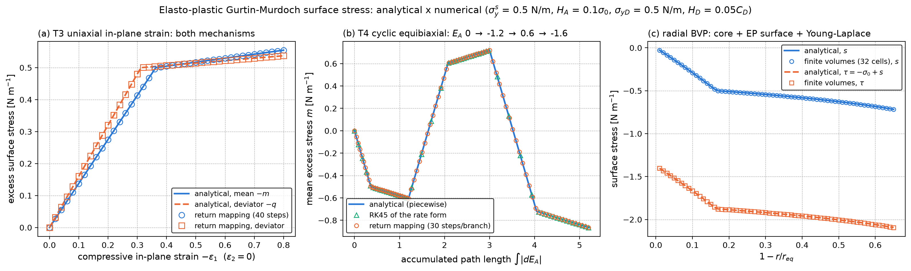
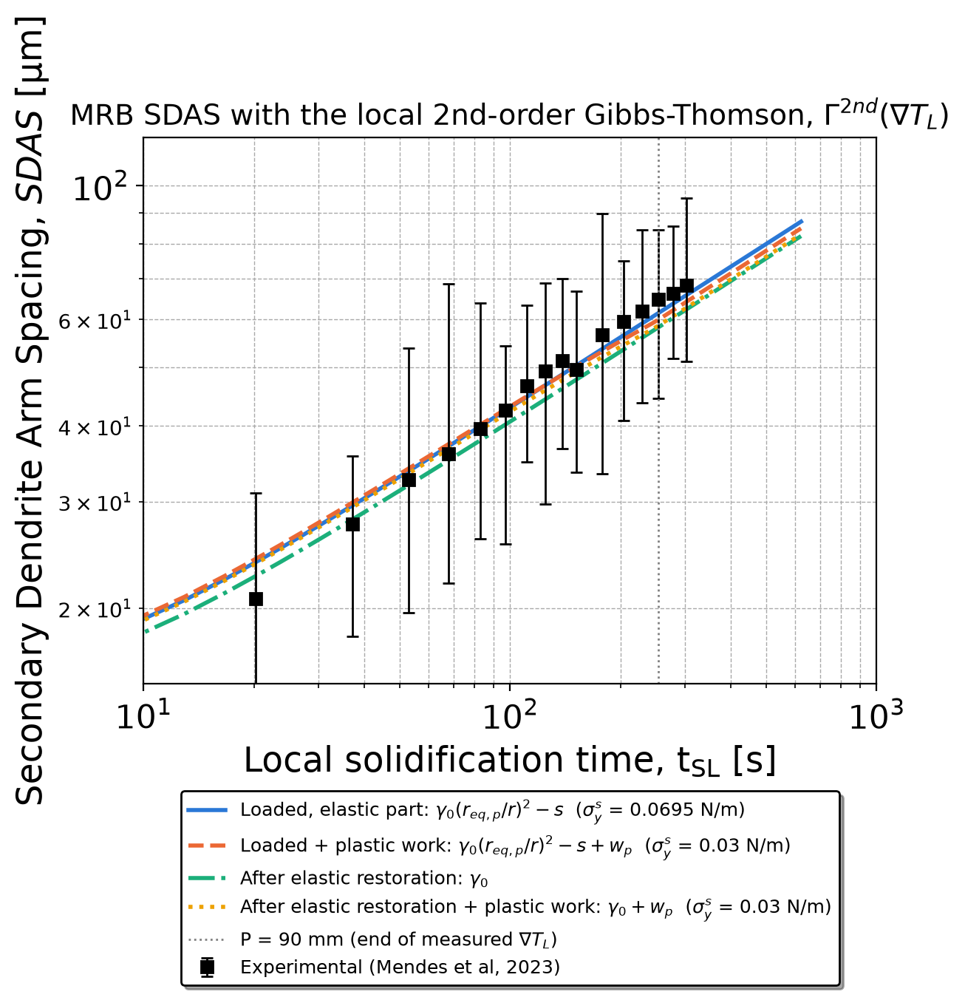
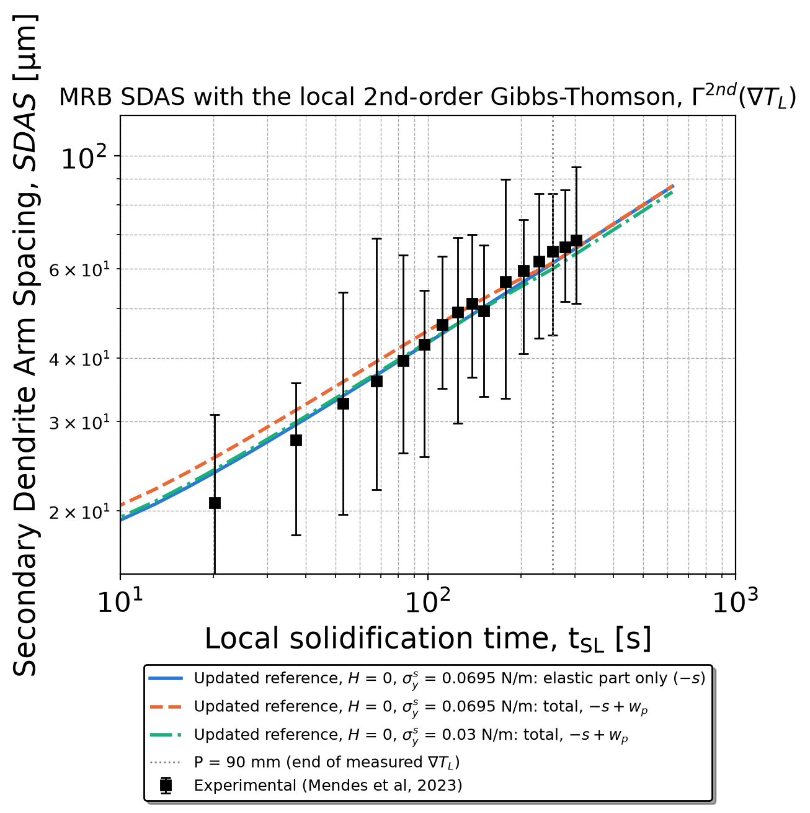

<h1 align="center">gm-elastoplastic-nucleation</h1>

<p align="center">
  <b>Elasto-plastic Gurtin–Murdoch surface in the thermal-field-tensor nucleation model</b><br>
  surface tension, surface energy and the 2nd-order Gibbs–Thomson tensor against the thermal gradient
</p>

<p align="center">
  
  
  
  
</p>

<p align="center"><b>English</b> · <a href="README.pt-BR.md">Português</a> · <a href="docs/FORMULATION.md"><b>Full formulation</b></a></p>

<p align="center">
  
</p>

**Below yield the elasto-plastic surface is the Gurtin–Murdoch surface itself.** Above it, the excess
surface stress is bounded by the areal yield stress and the permanent surface deformation is **stored
in the interface** (mode `stored_total`, adopted in October 2026): the surface energy and the 2nd-order
tensor follow the elastic branch closely and stay above the equilibrium $\gamma_0/|\Delta S_V|$, which
is what allows deformation-induced nucleation. Values at the mean experimental gradient of each alloy:

| Alloy | Mean gradient [K/m] | Yield [K/m] | Γ²ⁿᵈ elastic / elasto-plastic [m K] | γ_SL at 10⁵ K/m, el. / EP [J/m²] |
|---|---:|---:|---|---|
| Al-3Cu-5Nb-0.1Fe | 3 294 | 731 | 1.0685e-6 / 1.0627e-6 | 5.58 / 5.53 |
| Al-0.8Si-0.6Mg-0.2Fe | 7 902 | 925 | 1.5745e-6 / 1.5083e-6 | 4.45 / 4.24 |
| Al-3Cu-0.5Mg-0.2Fe | 3 708 | 562 | 1.0973e-6 / 1.0878e-6 | 4.35 / 4.29 |

The variant with the plastic area updating the equilibrium reference (surface energy and tensor
independent of the gradient) is kept in `model/` and in the results below as the initial study.

Extension of the nucleation model of Ferreira (Physica B 695, 416494, 2024), applied to the FCC_A1 phase
of the three alloys and propagated to the secondary dendrite arm spacing (SDAS) through the
modified Rappaz–Boettinger (MRB) model. A small CPU molecular-dynamics (MD) study of the solid–liquid
interface stress of Al is included as a check of the surface parameters.

Author: I.L. Ferreira, Faculty of Mechanical Engineering, Federal University of Pará (UFPA), Brazil.

## Contents

- [**Full formulation**](docs/FORMULATION.md): thermal field from the first law, thermal-field tensor, nucleation (critical radii and tensors of 1st and 2nd order), nucleation rate, Gurtin–Murdoch surface, elasto-plastic surface and its energy, numerical solution against the thermal gradient, MRB model of the SDAS
- [Repository layout](#repository-layout)
- [Theory](#theory): [Gurtin–Murdoch surface](#1-gurtinmurdoch-surface-gurtin-and-murdoch-1978-ferreira-2022-2024) · [elasto-plastic proposal](#2-elasto-plastic-proposal) · [energy of the plastic surface](#3-energy-of-the-elasto-plastic-surface)
- [Verification: analytical x numerical](#verification-analytical-x-numerical)
- [Main results](#main-results-al-3cu-5nb-01fe-mean-gradient-3294-km) · [SDAS with the local 2nd-order tensor](#sdas-with-the-local-2nd-order-tensor) · [All alloys in the stored_total mode](#all-alloys-in-the-stored_total-mode)
- [Running](#running) · [Data sources](#data-sources) · [Status](#status)
- [Acknowledgements](#acknowledgements)

## Repository layout

| Folder | What it holds |
|---|---|
| `model/` | Nucleation model with the elasto-plastic GM surface (`..._ElastoPlastic_GM.py`), the curve-by-curve comparison (`compare_GM_elastic_elastoplastic_B_MRS_2026.py`), the analytical x numerical verification (`verify_gm_elastoplastic_tensor.py`) and the two SDAS scripts (`..._GT_point_to_point.py`, `..._SDAS_vs_GL.py`); helpers `derivative_shim.py`, `midpoint.py` |
| `docs/` | Figures (comparison of the surfaces, verification, SDAS), badges and logos |
| `md_cpu/` | LAMMPS inputs and analysis for the planar interface stress and the Laplace pressure of a critical seed (`E5_results.md`) |
| `results/` | CSV tables and figures produced by the scripts and the MD runs |
| `nucleacao/` | The nucleation-model copies with the elasto-plastic surface (`*_EP.py`, mode `stored_total`), the shared module `gm_elastoplastic.py` (return mapping, energy modes), `figure_layout.py` and the helpers; comparison figures against the full gradient range (`figuras/`) and the collected tables |
| `sdas/` | The SDAS-model copies (`*_EP.py`) with the 2nd-order Gibbs–Thomson tensor of the elasto-plastic surface, and their figures |
| `ferramentas/` | Scripts that generate the copies from the original elastic models, run them, draw the comparison figures against the full gradient range (up to ~10⁶ K/m) and verify the results |
| `paper/` | The paper sources: `build_paper.py`, `make_figures.py` and the solution-sequence model `nucleation_elastoplastic_AlSiMgFe.py` (elastic and elasto-plastic surfaces solved side by side), with all paper outputs (sweep table, figures and panels). Sections 5.7-5.10 carry the recrystallization campaign (Figures 7-12, Tables 8-11); the manuscript is built to `..._v7_total.docx` |
| `recristalizacao/` | The recrystallization campaign (series E6, E6.5 and E6.6 in the records): LAMMPS inputs and chains (`ser_e65.sh`, `ser_e66.sh`), the raw logs behind the paper's Tables 8, 9 and 11, the pristine-control rulers of the hot-temperature CNA labels (`e65_serie26/`, `e66_data/`, `e66_analise/`), the analysis scripts and the figures |

## Theory

### 1. Gurtin–Murdoch surface (Gurtin and Murdoch, 1978; Ferreira, 2022, 2024)

On the nucleus surface $\mathcal{S}$, with surface gradient $\nabla_S$ and tangent projector
$\mathbf{P} = \mathbf{I} - \mathbf{n}\otimes\mathbf{n}$:

$$\nabla_S \cdot \boldsymbol{\Sigma} = \boldsymbol{\Theta}\,\mathbf{n} + \rho_0\,\ddot{\mathbf{u}}$$

$$\boldsymbol{\Sigma} = \sigma\,\mathbf{I} + 2\,(\mu_0 - \sigma)\,\mathbf{E} + (\lambda_0 - \sigma)\,(\mathrm{tr}\mathbf{E})\,\mathbf{I} + \sigma\,\nabla_S\mathbf{u} \qquad \text{on } \mathcal{S}$$

$$\mathbf{E} = \tfrac{1}{2}\left(D\mathbf{u} + D\mathbf{u}^{T}\right)$$

where $\boldsymbol{\Theta}$, $\mathbf{E}$ and $\mathbf{u}$ are the stress, strain and displacement fields,
$\sigma$ and $\rho_0$ the residual surface tension and surface mass density, and $\lambda_0$, $\mu_0$ the
surface Lamé moduli. Surface stress and surface energy are related by the Shuttleworth equation,

$$\Sigma_{\alpha\beta} = \gamma\,\delta_{\alpha\beta} + \frac{\partial \gamma}{\partial \varepsilon_{\alpha\beta}},$$

and the surface free energy of the nucleus is

$$\Delta G_S = \gamma_0\,\Phi\!\left(r_0^2 R\right) - \frac{1}{2A}\int_{\mathcal{S}} \Sigma_{ij}\,g^{ij}\,dA ,$$

with $R$ the Ricci scalar ($R = 2/r_0^2$ for a 2-sphere), $g^{ij}$ the metric of the deformed surface and
$r_0$ the radius at the equilibrium (undeformed) state.

**Spherical solution used in the scripts.** With bulk Lamé constants $\lambda$, $\mu$,

$$y(r) = (3\lambda + 2\mu)\,r + 2(\lambda_0 + \mu_0), \qquad y_0 = y(r_{eq}),$$

the excess surface stress, surface tension and surface energy are

$$s(r) = -2\,\sigma_0 \ln\frac{y_0}{y}, \qquad \tau(r) = -\sigma_0 + s(r), \qquad \gamma_{SL}(r) = \gamma_0\left(\frac{r_{eq}}{r}\right)^{2} - s(r).$$

$\sigma_0 < 0$ is a compressive force; in the scripts `sigma_0` holds its magnitude, so that
$\tau(r_{eq}) = -\sigma_0$. $\gamma_0$, $\sigma_0$ and $r_{eq}$ are equilibrium values: no deformation of the
created area. Writing $E_A = 2\ln(y/y_0)$ for the areal strain of the surface (partitioned with the bulk),
the elastic solution is $s = C_A E_A$ with areal modulus $C_A = \sigma_0$.

### 2. Elasto-plastic proposal

**Kinematics.** Additive split of the surface strain in the tangent plane,

$$\mathbf{E} = \mathbf{E}^{e} + \mathbf{E}^{p}, \qquad \mathbf{E}^{p} = \mathbf{P}\,\mathbf{E}^{p}\,\mathbf{P},$$

and the Gurtin–Murdoch law is evaluated with the elastic part:

$$\boldsymbol{\Sigma} = \sigma\,\mathbf{I} + 2\,(\mu_0 - \sigma)\,\mathbf{E}^{e} + (\lambda_0 - \sigma)\,(\mathrm{tr}\mathbf{E}^{e})\,\mathbf{I} + \sigma\,\nabla_S\mathbf{u}.$$

**Yield on the excess stress.** With $\tilde{\boldsymbol{\Sigma}} = \boldsymbol{\Sigma} - \sigma\,\mathbf{P}$, so that the
residual tension alone never yields, two decoupled mechanisms:

$$f_A = \left|\mathrm{tr}\tilde{\boldsymbol{\Sigma}}\right| - 2\,\sigma_y^{s}(\alpha_A) \le 0, \qquad \sigma_y^{s} = \sigma_{y0}^{s} + H_A\,\alpha_A \quad \text{(areal: coherent} \rightarrow \text{semicoherent interface)}$$

$$f_D = \left\lVert \mathrm{dev}_S \tilde{\boldsymbol{\Sigma}} \right\rVert - \sigma_{yD}(\alpha_D) \le 0, \qquad \sigma_{yD} = \sigma_{yD0} + H_D\,\alpha_D \quad \text{(J}_2\text{ in the tangent plane)}$$

**Flow rule and hardening (associative), with Kuhn–Tucker conditions:**

$$\dot{\mathbf{E}}^{p} = \dot{\lambda}_A\,\mathrm{sign}\!\left(\mathrm{tr}\tilde{\boldsymbol{\Sigma}}\right)\tfrac{1}{2}\mathbf{P} + \dot{\lambda}_D\,\frac{\mathrm{dev}_S\tilde{\boldsymbol{\Sigma}}}{\lVert \mathrm{dev}_S\tilde{\boldsymbol{\Sigma}} \rVert}, \qquad \dot{\alpha}_k = \dot{\lambda}_k, \qquad \dot{\lambda}_k \ge 0,\; f_k \le 0,\; \dot{\lambda}_k f_k = 0 .$$

For a spherical nucleus the surface strain is equibiaxial, $\mathbf{E} = \varepsilon\,\mathbf{P}$, so
$\mathrm{dev}_S\mathbf{E} = \mathbf{0}$ and the J$_2$ mechanism never activates (checked at run time);
only the areal mechanism changes the result.

**Return mapping (sphere, step $n \rightarrow n+1$, $r$ decreasing from $r_{eq}$):**

$$s^{tr} = C_A\left(E_A - E_{A,n}^{p}\right), \qquad f^{tr} = |s^{tr}| - \left(\sigma_{y0}^{s} + H_A\,\alpha_{A,n}\right)$$

$$\text{if } f^{tr} > 0:\quad \Delta\lambda = \frac{f^{tr}}{C_A + H_A},\quad s = s^{tr} - C_A\,\Delta\lambda\,\mathrm{sign}(s^{tr}),\quad E_{A,n+1}^{p} = E_{A,n}^{p} + \Delta\lambda\,\mathrm{sign}(s^{tr}),\quad \alpha_{A,n+1} = \alpha_{A,n} + \Delta\lambda$$

with consistent tangent $\partial s/\partial E_A = C_A H_A/(C_A + H_A)$ and the closed form, used as a check,

$$s = \mathrm{sign}(E_A)\left[\sigma_{y0}^{s} + \frac{H_A\,C_A}{C_A + H_A}\left(|E_A| - \frac{\sigma_{y0}^{s}}{C_A}\right)\right] \quad \text{for } |E_A| > \sigma_{y0}^{s}/C_A .$$

**Plastic area and the equilibrium reference.** The plastic area does not compress the surface energy; it
moves the reference at which $\gamma_0$, $\sigma_0$ and $r_{eq}$ were defined:

$$\gamma_{SL} = \gamma_0\left(\frac{r_{eq,p}}{r}\right)^{2} - s, \qquad r_{eq,p} = r_{eq}\,\exp\!\left(E_A^{p}/2\right)$$

(option `GM_PLASTIC_REFERENCE=1`; with $E_A^p = 0$ the elastic solution is recovered). For perfect
plasticity, $H_A = 0$, the surface energy after yield is independent of the radius and of the thermal
gradient:

$$\gamma_{SL} = \gamma_0\,e^{\sigma_y^{s}/C_A} + \sigma_y^{s}, \qquad \Gamma^{2nd} = \frac{\gamma_{SL}}{|\Delta S_V|} .$$

The matrix is a liquid (no shear), so plasticity is restricted to the surface.

### 3. Energy of the elasto-plastic surface

**Plastic work, stored energy and dissipation.** The surface free energy is
$\psi = \psi^{e}(\mathbf{E}^{e}) + \psi^{p}(\alpha_A)$ with $\psi^{p} = \tfrac{1}{2}H_A\alpha_A^2$, the energy stored by
hardening, whose thermodynamic force is $K = \partial\psi^{p}/\partial\alpha_A = H_A\alpha_A$. The Clausius–Duhem
inequality gives the dissipation $D = s\,\dot{E}_A^{p} - K\dot{\alpha}_A = \sigma_{y0}^{s}\,\dot{\alpha}_A \ge 0$, so the
plastic work splits into stored energy and heat:

$$w_p = \int \left(\sigma_{y0}^{s} + H_A\,\alpha_A\right) d\alpha_A = \psi^{p} + q_{diss}, \qquad \psi^{p} = \tfrac{1}{2}H_A\alpha_A^2, \qquad q_{diss} = \sigma_{y0}^{s}\,\alpha_A .$$

A hardened surface carries a larger elastic stress, $|s| = \sigma_{y0}^{s} + H_A\alpha_A$, which enters
$\gamma_{SL}$ through $-s$; the energy stored to sustain it is $\psi^{p}$.

**Loaded surface and elastic restoration.** As in a mechanical test (loading: elastic and plastic strain;
unloading: elastic restoration), the surface energy can be taken in the loaded state, under the Laplace
load at the critical radius, or after the elastic restoration ($s \rightarrow 0$, $\mathbf{E}^{e} \rightarrow 0$, the
reference following the plastic area):

| Option `GM_DISSIPATION_MODE` | $\gamma_{SL}$ |
|---|---|
| `stored_total` (**adopted**) | $\gamma_0\,(r_{eq}/r)^2 + \lvert\sigma_0\rvert\,(\lvert E^e\rvert + \lvert E^p\rvert) - q_{diss} = \gamma_0\,(r_{eq}/r)^2 - s - \sigma_y^s\,\alpha$ for $H_A = 0$ (loaded, fixed reference: the permanent deformation stays stored in the interface) |
| `stored` | $\gamma_0\,(r_{eq,p}/r)^2 - s$ (loaded, elastic part) |
| `thermo` | $\gamma_0\,(r_{eq,p}/r)^2 - s + \psi^{p}$ |
| `barrier` | $\gamma_0\,(r_{eq,p}/r)^2 - s + w_p$ (loaded, total: elastic + plastic) |
| `restored` | $\gamma_0$ (after the elastic restoration) |
| `restored_barrier` | $\gamma_0 + w_p$ |

$\Delta G_{diss} = 4\pi r^2 q_{diss}$ is reported in every mode. With perfect plasticity ($H_A = 0$) $\psi^{p} = 0$
and the recoverable elastic energy $s^2/(2C_A) = \sigma_y^2/(2C_A)$ is below 1 % of $w_p$.

The nucleation copies of `nucleacao/` and the paper run `stored_total` with $H_A = 0$ as the default energy
mode (author's decision, 2026-10-22): with the reference fixed, the stored permanent deformation leaves
$\Gamma^{2nd}$ only 0.5–4.2 % below the elastic tensor, growing with the gradient in the same way and always
above the equilibrium $\gamma_0/|\Delta S_V|$ — the interface carries energy available for
deformation-induced nucleation. With the reference updating, the tensor instead collapses onto a constant.

## Verification: analytical x numerical

`model/verify_gm_elastoplastic_tensor.py` tests the functions of the model file itself (extracted from
it, without running the script body).

<p align="center">
  
</p>

| Test | Numerical method | Max. difference to the analytical solution |
|---|---|---|
| Tangent-plane tensor: equibiaxial (sphere), pure shear (J₂), uniaxial (areal + J₂) | return mapping, 10–1000 steps | 1.1e-16 N/m |
| Cyclic equibiaxial, unloading and reverse yield | return mapping, 30–3000 steps per branch | 2.1e-13 N/m |
| Cyclic equibiaxial | RK45 of the rate form | 9.9e-8 N/m |
| Radial BVP: elastic core + EP surface + Young–Laplace | finite volumes (8–64 cells), Newton | 3e-16 (relative, u(R)/R) |
| ∂γ/∂r used by the tensor, all energy modes | central differences of γ(r) | ~3e-6 (relative) |
| Energy balance $w_p = \psi^p + q_{diss}$ | — | ~1e-15 (relative) |

With linear hardening and radial paths the return mapping is exact for any step size. The radial BVP has
a homogeneous linear-elastic core, so $u = A\rho$ exactly and the test checks the core–surface coupling,
not mesh convergence. The ~3e-6 floor in ∂γ/∂r comes from the tangent of the original script,
$\alpha = 2(\sigma + 2(\lambda_0+\mu_0))/[r(3\lambda+2\mu)]$, kept to reproduce the original solution exactly.

## Main results (Al-3Cu-5Nb-0.1Fe, mean gradient 3294 K/m)

The continuum formulation reproduces the experimental SDAS with both orders of the thermal-field
tensor: MRB with Gamma 1st order (3.887e-7 m K) and 2nd order (1.0685e-6 m K) fall within the
experimental scatter (Ferreira, JMEP manuscript, Table 6). The elasto-plastic surface of this
repository is an extension of that formulation, not a correction of it.

* Elastic branch: `GM_SURFACE_MODEL=elastic` reproduces the original solution exactly.
* Elasto-plastic surface with the plastic area updating the reference (`sigma_y` = 0.0695 N/m, `H` = 0):
  Gamma 2nd order = 3.887e-7 m K, the same at every experimental gradient (1.1–10.8 × 10³ K/m), and
  MRB SDAS = 7.67 t_SL^0.377 µm. `sigma_y` was obtained by matching the SDAS data; it is not an
  independent measurement.
* MD values of the GM surface parameters (Borovikov EAM, pure Al): `sigma_0` = −0.030 ± 0.007 N/m
  (24 000 atoms, 1 ns) and, in this repository, −0.040 ± 0.004 N/m (8192 atoms, 100 ps). Inputs taken
  from MD are an open issue on the MD side (pure Al, no solute, nanometre nuclei), not of the
  continuum theory.
* SDAS written explicitly in the thermal gradient: `SDAS = K (G_L V_L)^(-1/3)`; the free exponent
  against the cooling rate is −0.280 ± 0.059 (95 %), which contains −1/3.

### SDAS with the local 2nd-order tensor

At each position the 2nd-order tensor is computed at the measured thermal gradient
$\nabla T_L = T_R/V_L$ and passed to the MRB model (updated reference, $H_A = 0$).

<p align="center">
  
  
  <br>
  <sub>Left: loaded surface and surface after the elastic restoration, with and without the plastic work. Right: elastic part only and total energy (elastic + plastic). Experiments: Mendes et al. (2023).</sub>
</p>

| Surface state (updated reference, H = 0) | σ_y [N/m] | Γ²ⁿᵈ at 1119 → 3294 → 10772 K/m [m K] | MAPE | Exponent in t_SL |
|---|---:|---|---:|---:|
| Loaded, elastic part (`stored`) | 0.0695 | 3.89e-7 → 3.89e-7 → 3.89e-7 | 4.5 % | 0.379 |
| Loaded, total (`barrier`) | 0.0695 | 4.07e-7 → 4.73e-7 → 5.47e-7 | 6.2 % | 0.350 |
| Loaded, total (`barrier`) | 0.03 | 3.53e-7 → 3.83e-7 → 4.17e-7 | 5.6 % | 0.362 |
| After elastic restoration (`restored`) | any | 3.02e-7 (constant) | 7.2 % | 0.378 |
| After restoration + plastic work (`restored_barrier`) | 0.03 | 3.19e-7 → 3.49e-7 → 3.82e-7 | 6.2 % | 0.360 |

All curves fall within the experimental scatter (experimental exponent 0.443). The plastic work depends
on the path (it grows with the plastic area, larger near the chill), so it brings back a mild dependence
of Γ²ⁿᵈ on the gradient; the remaining gap in the exponent comes from the solidification kinetics
(t_SL, β of the MRB model), not from the surface energy. With hardening ($H_A > 0$) the stored energy
$\psi^{p}$ makes Γ²ⁿᵈ grow with the gradient and moves the SDAS away from the data.

### All alloys in the stored_total mode

The full nucleation suite of the three alloys (plus water) runs with the elasto-plastic surface in the
`stored_total` mode (`nucleacao/`); the figures of Section 5.4 of the paper come from
`paper/nucleation_elastoplastic_AlSiMgFe.py`. In the copies, ΔT is in closed form, so the elastic and the
elasto-plastic surfaces both sweep the whole range of solidification gradients, up to ~1.1 × 10⁶ K/m:

| Alloy | Yield ∇T [K/m] | Γ²ⁿᵈ el. / EP at ∇T̄ [m K] | Γ²ⁿᵈ el. / EP at 10⁵ K/m [m K] | γ el. / EP at 10⁵ K/m [J/m²] |
|---|---:|---|---|---|
| Al-3Cu-5Nb-0.1Fe (3 294 K/m) | 731 | 1.0685e-6 / 1.0627e-6 | 5.693e-6 / 5.644e-6 | 5.58 / 5.53 |
| Al-0.8Si-0.6Mg-0.2Fe (7 902 K/m) | 925 | 1.5745e-6 / 1.5083e-6 | 4.805e-6 / 4.581e-6 | 4.45 / 4.24 |
| Al-3Cu-0.5Mg-0.2Fe (3 708 K/m) | 562 | 1.0973e-6 / 1.0878e-6 | 5.210e-6 / 5.142e-6 | 4.35 / 4.29 |

The peak of the nucleation rate (elastic → elasto-plastic): 6.62e49 → 6.37e49 m⁻³ s⁻¹ (Al-Cu-Nb-Fe),
1.01e50 → 8.19e49 (Al-Si-Mg-Fe) and 1.43e50 → 1.33e50 (Al-Cu-Mg-Fe). Comparison figures against ∇T with
the yield point marked (shaded band: elastic range, dash-dot line: yield) come from
`ferramentas/comparar_curvas_EP.py`, `comparar_taxa_nucleacao.py`, `energia_superficie_alto_gradiente.py`
and `gibbs_thomson_alto_gradiente.py`, and are also in `nucleacao/figuras/`.

## Running

Python 3.11 with NumPy, SciPy and Matplotlib. From `model/`:

```bash
# elastic GM (reproduces the original script exactly) and elasto-plastic GM
GM_SURFACE_MODEL=elastic python Nucleation_model_..._ElastoPlastic_GM.py
python Nucleation_model_..._ElastoPlastic_GM.py
# elasto-plastic with the plastic area updating the reference
GM_PLASTIC_REFERENCE=1 GM_SIGMA_YA0=0.0695 GM_H_A=0 python Nucleation_model_..._ElastoPlastic_GM.py
# energy of the surface: GM_DISSIPATION_MODE = stored_total (default in nucleacao/) | stored | thermo | barrier | restored | restored_barrier
GM_PLASTIC_REFERENCE=1 GM_SIGMA_YA0=0.03 GM_H_A=0 GM_DISSIPATION_MODE=barrier python Nucleation_model_..._ElastoPlastic_GM.py
GM_PLASTIC_REFERENCE=1 GM_SIGMA_YA0=0.0695 GM_H_A=0 GM_DISSIPATION_MODE=restored python Nucleation_model_..._ElastoPlastic_GM.py
GM_PLASTIC_REFERENCE=1 GM_SIGMA_YA0=0.03 GM_H_A=0 GM_DISSIPATION_MODE=restored_barrier python Nucleation_model_..._ElastoPlastic_GM.py
# curve-by-curve comparison (reads the three tablefull_*.csv files written above)
python compare_GM_elastic_elastoplastic_B_MRS_2026.py
# analytical x numerical verification of the surface stress tensor
python verify_gm_elastoplastic_tensor.py
# SDAS with the local 2nd-order tensor (reads the GT_point_to_point_*.csv files written above)
GM_SDAS_CASES=restoration  python scriptsdasmodelAl3Cu5Nb01Fe_zoom_horizontal_B_MRS_Meeting_2026_GT_point_to_point.py
GM_SDAS_CASES=total_energy python scriptsdasmodelAl3Cu5Nb01Fe_zoom_horizontal_B_MRS_Meeting_2026_GT_point_to_point.py
python scriptsdasmodelAl3Cu5Nb01Fe_zoom_horizontal_B_MRS_Meeting_2026_SDAS_vs_GL.py
```

The model writes its CSV files in the working directory; the ones used for the figures are also in
`results/continuum/` and `results/sdas/`. When several cases run in parallel in the same folder, the
files of the comparison section at the end of the model script are overwritten by the last run.

The `stored_total` suite, from the repository root:

```bash
cd nucleacao
GM_SURFACE_MODEL=elastic python Nucleation_model_FCC_A1_new_paper_2024_dev_full_GLH_AlSiMgFe_signal_beta_2nd_Sim_Luane_EP.py  # elastic branch
python Nucleation_model_FCC_A1_new_paper_2024_dev_full_GLH_AlSiMgFe_signal_beta_2nd_Sim_Luane_EP.py  # elasto-plastic (stored_total)
# the three alloys of the paper: ..._AlCuNbFe_..._2026_paper_EP.py, ..._AlSiMgFe_..._Sim_Luane_EP.py, ..._AlCuMgFe_..._2026_paper_EP.py
# each run writes its CSVs and its own figures against the thermal gradient (rate, Γ²ⁿᵈ, γ, τ, energies and entropies)
cd ../ferramentas
python comparar_curvas_EP.py             # elastic x elasto-plastic against ∇T, yield marked
python gibbs_thomson_alto_gradiente.py   # Γ²ⁿᵈ of the three alloys up to 10⁶ K/m
cd ../paper
python nucleation_elastoplastic_AlSiMgFe.py   # every output of the paper for Al-0.8Si-0.6Mg-0.2Fe: sweep table, figures, panels (default --show=all)
```

`aplicar_elastoplastico.py` regenerates the `*_EP.py` copies from the original elastic models (the source
paths in its header point to the author's workspace), `rodar_modelos_EP.py` runs every copy and collects
the tables, and `paper/build_paper.py` (after `paper/make_figures.py`) builds the manuscript (saved as
`Manuscript_..._v7_total.docx` in the author's Paper folder).

Recrystallization campaign (E6 family; on the GPU box, LAMMPS 30Sep2026 with the GPU package):

```bash
cd recristalizacao
bash ser_e65.sh            # the big-cell E6.5 series + the pristine controls (Mendelev EAM, -sf gpu, ~1 h)
bash ser_e66.sh            # E6.6: the NVT/NPT rulers, the unloadings (E6.4 protocol) and the wide-gamma runs; 21 runs, ~13.5 h
python3 -I analyze_e66.py  # on the box: reguas.csv, descarrega.csv, largo.csv and the frame series -> e66_analise/
```

The series codes (E5 in `md_cpu/`, E6.1-E6.6 in `recristalizacao/`) are the campaign's records; the
paper's Sections 5.7-5.10 introduce them exactly so, anchored to this repository.

MD (LAMMPS 10Sep2025; on Windows the OpenMP build: `lmp -sf omp -pk omp 8 -in ...`). Download
`Ni-Al-Nb.eam.fs` (Borovikov et al., Int. J. Plast. 178, 104004, 2024) from the NIST Interatomic
Potentials Repository into `potentials/`. `in.planar_stress` starts from a solid–liquid coexistence slab
(`-var coexist <file>`).

## Data sources

Thermal gradients (`G_L = T_R / V_L`) and SDAS: horizontal transient solidification of
Al-3Cu-5Nb-0.1Fe, Mendes et al. (2023). Alloy, diffusion and partition data as in the original
scripts of the author.

## Status

Research code under development. The yield stress of the interface still needs an independent value
(the series of seeds of 1.5–3.0 nm in `md_cpu/` would give the radius dependence of the interface stress).

October 2026: the nucleation copies and the paper adopt the `stored_total` surface energy (fixed
reference, permanent deformation stored); the manuscript
"Elasto-Plastic Gurtin–Murdoch Surface in Non-Equilibrium Phase Nucleation: Stored Permanent Surface
Deformation, Elastic Restoration and the Thermal-Field Tensor" is built by `paper/build_paper.py`
(current output: `..._v7_total.docx`, with the recrystallization campaign of `recristalizacao/` in
Sections 5.7-5.10: Figures 7-12 and Tables 8-11 - the MD verification of the stored energy, the
hot-temperature CNA baselines of the pristine controls, the unloadings to zero stress and the
gradual release onto the persistent plateau of 3-6 × 10⁷ J m⁻³, the order of σ_y^s·α/δ with the
measured deformed-zone thickness).

Correction (October 2026): the derivative of the plastic work used in ∂γ/∂r in the `barrier` mode had
the wrong sign; it affected only the 1st-order quantities in that mode. γ, ΔT, ∇T and Γ²ⁿᵈ do not
depend on it.

## Acknowledgements

This work was supported by the Brazilian National Council for Scientific and Technological
Development (**CNPq**), the Coordination for the Improvement of Higher Education Personnel
(**CAPES**) and the Federal University of Pará (**UFPA**).

<p align="center">
  <a href="https://www.gov.br/cnpq"></a>
  &nbsp;&nbsp;&nbsp;&nbsp;
  <a href="https://www.gov.br/capes"></a>
  &nbsp;&nbsp;&nbsp;&nbsp;
  <a href="https://ufpa.br"></a>
</p>
