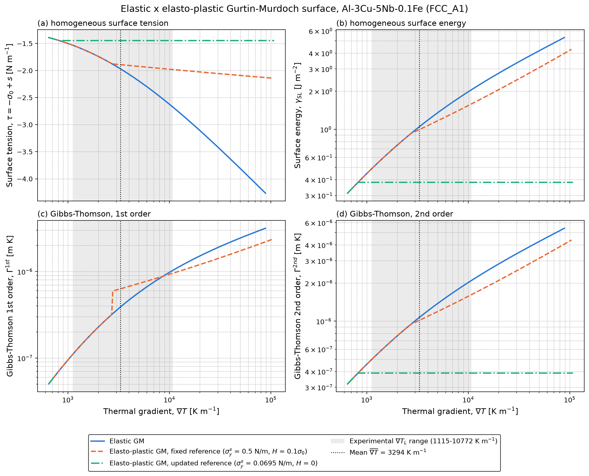

<h1 align="center">gm-elastoplastic-nucleation</h1>

<p align="center">
  <b>Superfície elasto-plástica de Gurtin–Murdoch no modelo de nucleação com o tensor de campo térmico</b><br>
  tensão de superfície, energia de superfície e tensores de Gibbs–Thomson de 1ª e 2ª ordem em função do gradiente térmico
</p>

<p align="center">
  
  
  
  
</p>

<p align="center"><a href="README.md">English</a> · <b>Português</b></p>

<p align="center">
  
</p>

**Abaixo do escoamento, a superfície elasto-plástica é a própria superfície de Gurtin–Murdoch.** Acima
dele, a tensão de superfície em excesso fica limitada e, com a área plástica atualizando a referência de
equilíbrio, a energia de superfície e o tensor de 2ª ordem deixam de depender do gradiente térmico.
Al-3Cu-5Nb-0,1Fe (FCC_A1), gradiente médio de 3294 K/m:

| Superfície | τ [N/m] | γ_SL [J/m²] | Γ¹ˢᵗ [m K] | Γ²ⁿᵈ [m K] |
|---|---:|---:|---:|---:|
| GM elástica | −1,968 | 1,047 | 3,887e-7 | 1,0685e-6 |
| Elasto-plástica, referência fixa (σ_y = 0,5 N/m, H = 0,1σ₀) | −1,891 | 0,994 | 6,310e-7 | 1,0146e-6 |
| Elasto-plástica, referência atualizada (σ_y = 0,0695 N/m, H = 0) | −1,446 | 0,381 | não definido após o escoamento | 3,887e-7 |

Extensão do modelo de nucleação de Ferreira (Physica B 695, 416494, 2024), aplicada à fase FCC_A1 da liga
Al-3Cu-5Nb-0,1Fe e propagada ao espaçamento dendrítico secundário (SDAS) pelo modelo de Rappaz–Boettinger
modificado (MRB). Inclui um estudo curto de dinâmica molecular (MD) em CPU da tensão de interface
sólido–líquido do Al, para verificar os parâmetros de superfície.

Autor: I.L. Ferreira, Faculdade de Engenharia Mecânica, Universidade Federal do Pará (UFPA), Brasil.

## Sumário

- [Organização do repositório](#organização-do-repositório)
- [Teoria](#teoria): [superfície de Gurtin–Murdoch](#1-superfície-de-gurtinmurdoch-gurtin-e-murdoch-1978-ferreira-2022-2024) · [proposta elasto-plástica](#2-proposta-elasto-plástica)
- [Resultados principais](#resultados-principais-al-3cu-5nb-01fe-gradiente-médio-de-3294-km)
- [Como rodar](#como-rodar) · [Origem dos dados](#origem-dos-dados) · [Estado](#estado)
- [Agradecimentos](#agradecimentos)

## Organização do repositório

| Pasta | Conteúdo |
|---|---|
| `model/` | Modelo de nucleação com a superfície GM elasto-plástica (`..._ElastoPlastic_GM.py`), a comparação curva a curva (`compare_GM_elastic_elastoplastic_B_MRS_2026.py`) e os dois scripts de SDAS (`..._GT_point_to_point.py`, `..._SDAS_vs_GL.py`); auxiliares `derivative_shim.py`, `midpoint.py` |
| `docs/` | Figura da comparação, badges e logos |
| `md_cpu/` | Entradas do LAMMPS e análises da tensão de interface plana e da pressão de Laplace de um núcleo crítico (`E5_results.md`) |
| `results/` | Tabelas CSV e figuras geradas pelos scripts e pelas corridas de MD |

## Teoria

### 1. Superfície de Gurtin–Murdoch (Gurtin e Murdoch, 1978; Ferreira, 2022, 2024)

Na superfície do núcleo $\mathcal{S}$, com gradiente de superfície $\nabla_S$ e projetor tangente
$\mathbf{P} = \mathbf{I} - \mathbf{n}\otimes\mathbf{n}$:

$$\nabla_S \cdot \boldsymbol{\Sigma} = \boldsymbol{\Theta}\,\mathbf{n} + \rho_0\,\ddot{\mathbf{u}}$$

$$\boldsymbol{\Sigma} = \sigma\,\mathbf{I} + 2\,(\mu_0 - \sigma)\,\mathbf{E} + (\lambda_0 - \sigma)\,(\operatorname{tr}\mathbf{E})\,\mathbf{I} + \sigma\,\nabla_S\mathbf{u} \qquad \text{em } \mathcal{S}$$

$$\mathbf{E} = \tfrac{1}{2}\left(D\mathbf{u} + D\mathbf{u}^{T}\right)$$

em que $\boldsymbol{\Theta}$, $\mathbf{E}$ e $\mathbf{u}$ são os campos de tensão, deformação e deslocamento,
$\sigma$ e $\rho_0$ a tensão superficial residual e a massa específica de superfície, e $\lambda_0$, $\mu_0$ os
módulos de Lamé da superfície. Tensão e energia de superfície se relacionam pela equação de Shuttleworth,

$$\Sigma_{\alpha\beta} = \gamma\,\delta_{\alpha\beta} + \frac{\partial \gamma}{\partial \varepsilon_{\alpha\beta}},$$

e a energia livre de superfície do núcleo é

$$\Delta G_S = \gamma_0\,\Phi\!\left(r_0^2 R\right) - \frac{1}{2A}\int_{\mathcal{S}} \Sigma_{ij}\,g^{ij}\,dA ,$$

com $R$ o escalar de Ricci ($R = 2/r_0^2$ numa 2-esfera), $g^{ij}$ a métrica da superfície deformada e $r_0$
o raio no estado de equilíbrio (não deformado).

**Solução esférica usada nos scripts.** Com as constantes de Lamé do volume $\lambda$, $\mu$,

$$y(r) = (3\lambda + 2\mu)\,r + 2(\lambda_0 + \mu_0), \qquad y_0 = y(r_{eq}),$$

a tensão de superfície em excesso, a tensão superficial e a energia de superfície são

$$s(r) = -2\,\sigma_0 \ln\frac{y_0}{y}, \qquad \tau(r) = -\sigma_0 + s(r), \qquad \gamma_{SL}(r) = \gamma_0\left(\frac{r_{eq}}{r}\right)^{2} - s(r).$$

$\sigma_0 < 0$ é uma força compressiva; nos scripts `sigma_0` guarda o seu módulo, de modo que
$\tau(r_{eq}) = -\sigma_0$. $\gamma_0$, $\sigma_0$ e $r_{eq}$ são valores de equilíbrio: sem deformação da área
criada. Escrevendo $E_A = 2\ln(y/y_0)$ para a deformação de área da superfície (repartida com o volume), a
solução elástica é $s = C_A E_A$, com módulo de área $C_A = \sigma_0$.

### 2. Proposta elasto-plástica

**Cinemática.** Decomposição aditiva da deformação de superfície no plano tangente,

$$\mathbf{E} = \mathbf{E}^{e} + \mathbf{E}^{p}, \qquad \mathbf{E}^{p} = \mathbf{P}\,\mathbf{E}^{p}\,\mathbf{P},$$

e a lei de Gurtin–Murdoch é avaliada com a parte elástica:

$$\boldsymbol{\Sigma} = \sigma\,\mathbf{I} + 2\,(\mu_0 - \sigma)\,\mathbf{E}^{e} + (\lambda_0 - \sigma)\,(\operatorname{tr}\mathbf{E}^{e})\,\mathbf{I} + \sigma\,\nabla_S\mathbf{u}.$$

**Escoamento sobre a tensão em excesso.** Com $\tilde{\boldsymbol{\Sigma}} = \boldsymbol{\Sigma} - \sigma\,\mathbf{P}$, para que a
tensão residual sozinha nunca escoe, dois mecanismos desacoplados:

$$f_A = \left|\operatorname{tr}\tilde{\boldsymbol{\Sigma}}\right| - 2\,\sigma_y^{s}(\alpha_A) \le 0, \qquad \sigma_y^{s} = \sigma_{y0}^{s} + H_A\,\alpha_A \quad \text{(área: interface coerente} \rightarrow \text{semicoerente)}$$

$$f_D = \left\lVert \operatorname{dev}_S \tilde{\boldsymbol{\Sigma}} \right\rVert - \sigma_{yD}(\alpha_D) \le 0, \qquad \sigma_{yD} = \sigma_{yD0} + H_D\,\alpha_D \quad \text{(J}_2\text{ no plano tangente)}$$

**Lei de fluxo e endurecimento (associativos), com as condições de Kuhn–Tucker:**

$$\dot{\mathbf{E}}^{p} = \dot{\lambda}_A\,\operatorname{sign}\!\left(\operatorname{tr}\tilde{\boldsymbol{\Sigma}}\right)\tfrac{1}{2}\mathbf{P} + \dot{\lambda}_D\,\frac{\operatorname{dev}_S\tilde{\boldsymbol{\Sigma}}}{\lVert \operatorname{dev}_S\tilde{\boldsymbol{\Sigma}} \rVert}, \qquad \dot{\alpha}_k = \dot{\lambda}_k, \qquad \dot{\lambda}_k \ge 0,\; f_k \le 0,\; \dot{\lambda}_k f_k = 0 .$$

Num núcleo esférico a deformação de superfície é equibiaxial, $\mathbf{E} = \varepsilon\,\mathbf{P}$, logo
$\operatorname{dev}_S\mathbf{E} = \mathbf{0}$ e o mecanismo J$_2$ nunca é ativado (verificado na execução); só o
mecanismo de área muda o resultado.

**Return mapping (esfera, passo $n \rightarrow n+1$, $r$ diminuindo a partir de $r_{eq}$):**

$$s^{tr} = C_A\left(E_A - E_{A,n}^{p}\right), \qquad f^{tr} = |s^{tr}| - \left(\sigma_{y0}^{s} + H_A\,\alpha_{A,n}\right)$$

$$\text{se } f^{tr} > 0:\quad \Delta\lambda = \frac{f^{tr}}{C_A + H_A},\quad s = s^{tr} - C_A\,\Delta\lambda\,\operatorname{sign}(s^{tr}),\quad E_A^{p} \mathrel{+}= \Delta\lambda\,\operatorname{sign}(s^{tr}),\quad \alpha_A \mathrel{+}= \Delta\lambda$$

com tangente consistente $\partial s/\partial E_A = C_A H_A/(C_A + H_A)$ e a forma fechada, usada como verificação,

$$s = \operatorname{sign}(E_A)\left[\sigma_{y0}^{s} + \frac{H_A\,C_A}{C_A + H_A}\left(|E_A| - \frac{\sigma_{y0}^{s}}{C_A}\right)\right] \quad \text{para } |E_A| > \sigma_{y0}^{s}/C_A .$$

**Área plástica e a referência de equilíbrio.** A área plástica não comprime a energia de superfície; ela
desloca a referência em que $\gamma_0$, $\sigma_0$ e $r_{eq}$ foram definidos:

$$\gamma_{SL} = \gamma_0\left(\frac{r_{eq,p}}{r}\right)^{2} - s, \qquad r_{eq,p} = r_{eq}\,\exp\!\left(E_A^{p}/2\right)$$

(opção `GM_PLASTIC_REFERENCE=1`; com $E_A^p = 0$ a solução elástica é recuperada). Com plasticidade perfeita,
$H_A = 0$, a energia de superfície depois do escoamento não depende do raio nem do gradiente térmico:

$$\gamma_{SL} = \gamma_0\,e^{\sigma_y^{s}/C_A} + \sigma_y^{s}, \qquad \Gamma^{2nd} = \frac{\gamma_{SL}}{|\Delta S_V|} .$$

**Trabalho dissipado.** $w_p = \int \sigma_y^{s}\,d\alpha_A$ [J m⁻²] fica fora da barreira e é reportado como
$\Delta G_{diss} = 4\pi r^2 w_p$ (`stored`, padrão) ou é somado a $\gamma_{SL}$ (`barrier`, limite superior).
A matriz é um líquido (sem cisalhamento), de modo que a plasticidade fica restrita à superfície.

## Resultados principais (Al-3Cu-5Nb-0,1Fe, gradiente médio de 3294 K/m)

A formulação do contínuo reproduz o SDAS experimental com as duas ordens do tensor de campo térmico: o MRB
com Γ de 1ª ordem (3,887e-7 m K) e de 2ª ordem (1,0685e-6 m K) fica dentro da dispersão experimental
(Ferreira, manuscrito JMEP, Tabela 6). A superfície elasto-plástica deste repositório é uma extensão dessa
formulação, não uma correção dela.

* Ramo elástico: `GM_SURFACE_MODEL=elastic` reproduz exatamente a solução original.
* Superfície elasto-plástica com a área plástica atualizando a referência (`sigma_y` = 0,0695 N/m, `H` = 0):
  Γ de 2ª ordem = 3,887e-7 m K, o mesmo em todos os gradientes experimentais (1,1–10,8 × 10³ K/m), e
  SDAS pelo MRB = 7,67 t_SL^0,377 µm. `sigma_y` foi obtido pelo ajuste aos dados de SDAS; não é uma medida
  independente.
* Parâmetros de superfície GM pela MD (Borovikov EAM, Al puro): `sigma_0` = −0,030 ± 0,007 N/m
  (24 000 átomos, 1 ns) e, neste repositório, −0,040 ± 0,004 N/m (8192 átomos, 100 ps). As entradas
  vindas da MD são uma questão em aberto do lado da MD (Al puro, sem soluto, núcleos nanométricos), não
  da teoria do contínuo.
* SDAS escrito explicitamente no gradiente térmico: `SDAS = K (G_L V_L)^(-1/3)`; o expoente livre contra a
  taxa de resfriamento é −0,280 ± 0,059 (95 %), intervalo que contém −1/3.

## Como rodar

Python 3.11 com NumPy, SciPy e Matplotlib. Na pasta `model/`:

```bash
# GM elástica (reproduz exatamente o script original) e GM elasto-plástica
GM_SURFACE_MODEL=elastic python Nucleation_model_..._ElastoPlastic_GM.py
python Nucleation_model_..._ElastoPlastic_GM.py
# elasto-plástica com a área plástica atualizando a referência
GM_PLASTIC_REFERENCE=1 GM_SIGMA_YA0=0.0695 GM_H_A=0 python Nucleation_model_..._ElastoPlastic_GM.py
# comparação curva a curva (lê os três tablefull_*.csv gerados acima)
python compare_GM_elastic_elastoplastic_B_MRS_2026.py
# SDAS (lê os GT_point_to_point_*.csv gerados acima)
python scriptsdasmodelAl3Cu5Nb01Fe_zoom_horizontal_B_MRS_Meeting_2026_GT_point_to_point.py
python scriptsdasmodelAl3Cu5Nb01Fe_zoom_horizontal_B_MRS_Meeting_2026_SDAS_vs_GL.py
```

MD (LAMMPS 10Sep2025; no Windows, a versão OpenMP: `lmp -sf omp -pk omp 8 -in ...`). Baixe
`Ni-Al-Nb.eam.fs` (Borovikov et al., Int. J. Plast. 178, 104004, 2024) do NIST Interatomic Potentials
Repository para `potentials/`. `in.planar_stress` parte de uma placa sólido–líquido em coexistência
(`-var coexist <arquivo>`).

## Origem dos dados

Gradientes térmicos (`G_L = T_R / V_L`) e SDAS: solidificação transiente horizontal da liga
Al-3Cu-5Nb-0,1Fe, Mendes et al. (2023). Dados da liga, de difusão e de partição como nos scripts
originais do autor.

## Estado

Código de pesquisa em desenvolvimento. A tensão de escoamento da interface ainda precisa de um valor
independente (a série de núcleos de 1,5–3,0 nm em `md_cpu/` daria a dependência da tensão de interface
com o raio).

## Agradecimentos

Este trabalho foi apoiado pelo Conselho Nacional de Desenvolvimento Científico e Tecnológico (**CNPq**),
pela Coordenação de Aperfeiçoamento de Pessoal de Nível Superior (**CAPES**) e pela Universidade Federal do
Pará (**UFPA**).

<p align="center">
  <a href="https://www.gov.br/cnpq"></a>
  &nbsp;&nbsp;&nbsp;&nbsp;
  <a href="https://www.gov.br/capes"></a>
  &nbsp;&nbsp;&nbsp;&nbsp;
  <a href="https://ufpa.br"></a>
</p>
