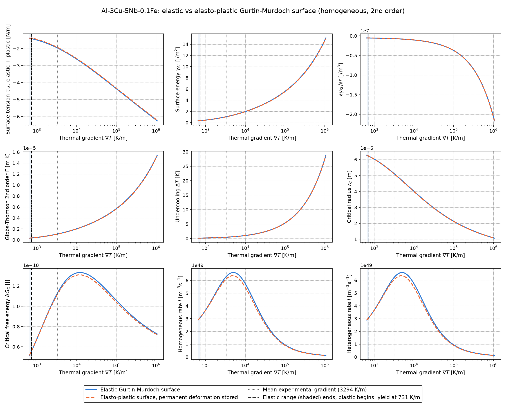
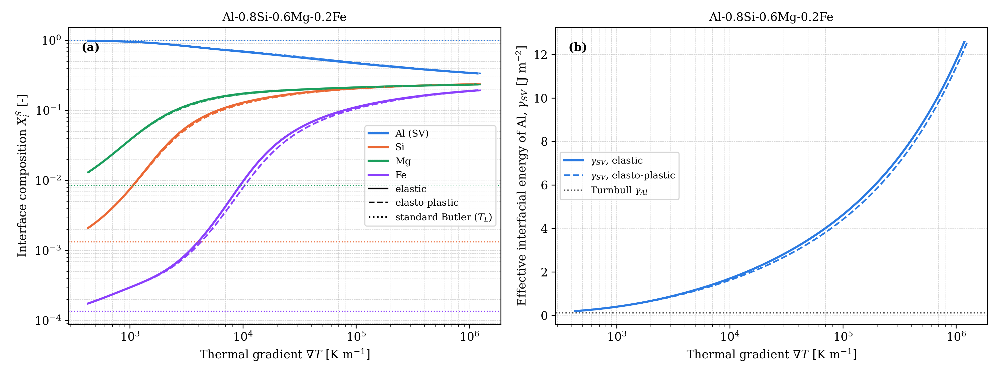
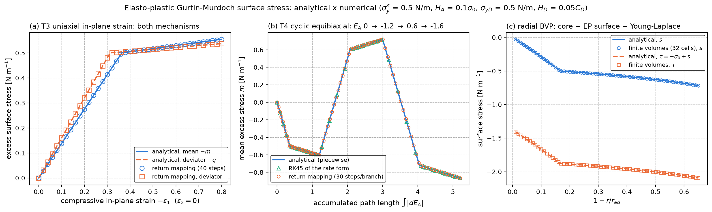
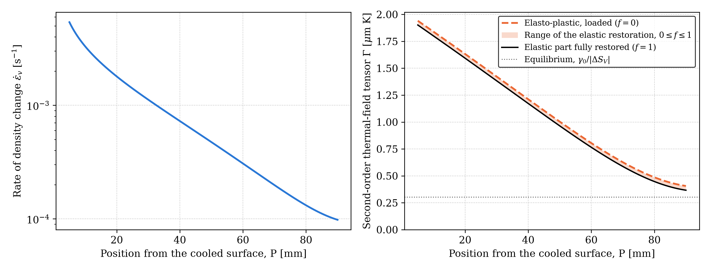
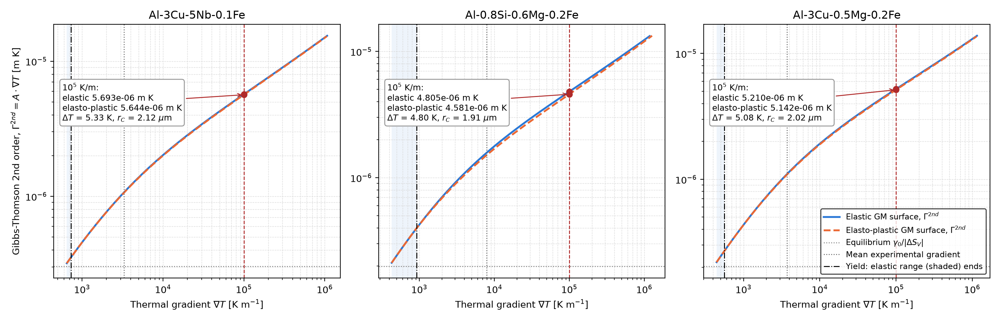
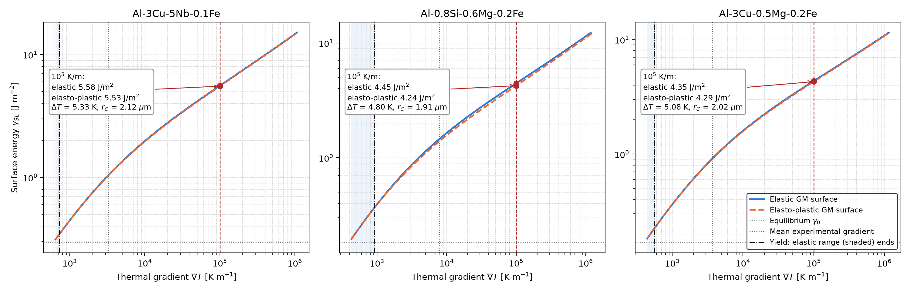
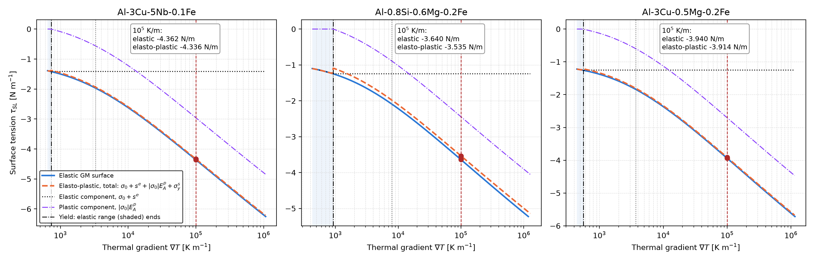
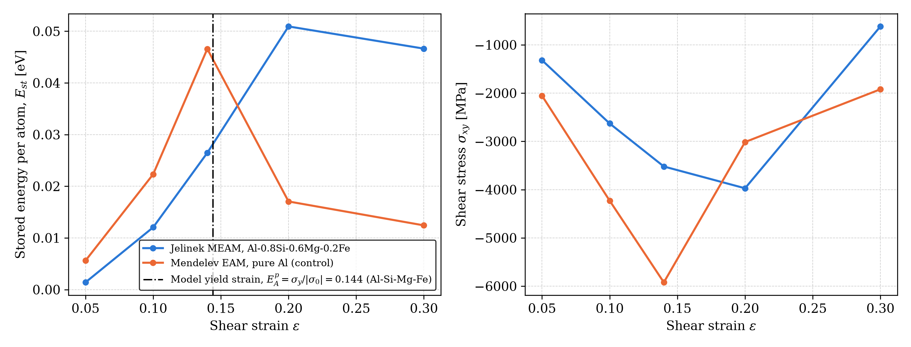
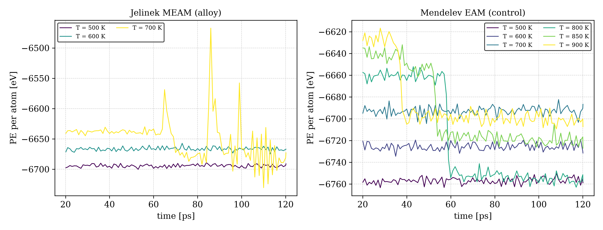
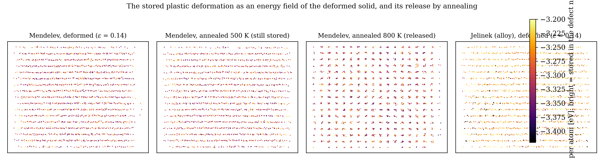

<h1 align="center">gm-elastoplastic-nucleation</h1>

<p align="center">
  <b>Superfície elasto-plástica de Gurtin–Murdoch no modelo de nucleação com o tensor de campo térmico</b><br>
  tensão de superfície, energia de superfície e tensor de Gibbs–Thomson de 2ª ordem em função do gradiente térmico
</p>

<p align="center">
  
  
  
  
</p>

<p align="center"><a href="README.md">English</a> · <b>Português</b> · <a href="docs/FORMULACAO.pt-BR.md"><b>Formulação completa</b></a></p>

<p align="center">
  
  <br>
  <sub>Al-3Cu-5Nb-0,1Fe (FCC_A1): superfícies de Gurtin–Murdoch elástica (contínua) e elasto-plástica <code>stored_total</code> (tracejada) em função do gradiente térmico; traço-ponto: escoamento em 731 K/m (Figura 1 do paper).</sub>
</p>

**Abaixo do escoamento, a superfície elasto-plástica é a própria superfície de Gurtin–Murdoch.** Acima
dele, a tensão de superfície em excesso fica limitada pela tensão de escoamento de área e a deformação
permanente fica **armazenada na interface** (modo `stored_total`, adotado em outubro de 2026): a energia
de superfície e o tensor de 2ª ordem acompanham de perto o ramo elástico e ficam acima do equilíbrio
$\gamma_0/|\Delta S_V|$, o que permite a nucleação induzida por deformação. Valores no gradiente térmico
médio experimental de cada liga:

| Liga | Gradiente médio [K/m] | Escoamento [K/m] | Γ²ⁿᵈ elástico / elasto-plástico [m K] | γ_SL em 10⁵ K/m, el. / EP [J/m²] |
|---|---:|---:|---|---|
| Al-3Cu-5Nb-0,1Fe | 3 294 | 731 | 1,0685e-6 / 1,0627e-6 | 5,58 / 5,53 |
| Al-0,8Si-0,6Mg-0,2Fe | 7 902 | 925 | 1,5745e-6 / 1,5083e-6 | 4,45 / 4,24 |
| Al-3Cu-0,5Mg-0,2Fe | 3 708 | 562 | 1,0973e-6 / 1,0878e-6 | 4,35 / 4,29 |

A variante com a área plástica atualizando a referência de equilíbrio (energia de superfície e tensor
independentes do gradiente) fica em `model/` e nos resultados abaixo, como estudo inicial.

Extensão do modelo de nucleação de Ferreira (Physica B 695, 416494, 2024), aplicada à fase FCC_A1 das
três ligas e propagada ao espaçamento dendrítico secundário (SDAS) pelo modelo de Rappaz–Boettinger
modificado (MRB). Inclui um estudo curto de dinâmica molecular (MD) em CPU da tensão de interface
sólido–líquido do Al, para verificar os parâmetros de superfície.

Autor: I.L. Ferreira, Faculdade de Engenharia Mecânica, Universidade Federal do Pará (UFPA), Brasil.

## Sumário

- [**Formulação completa**](docs/FORMULACAO.pt-BR.md): campo térmico pela 1ª lei, tensor de campo térmico, nucleação (raios críticos e tensores de 1ª e 2ª ordem), taxa de nucleação, superfície de Gurtin–Murdoch, superfície elasto-plástica e sua energia, solução numérica em função do gradiente térmico, modelo MRB do SDAS
- [Organização do repositório](#organização-do-repositório)
- [Teoria](#teoria): [superfície de Gurtin–Murdoch](#1-superfície-de-gurtinmurdoch-gurtin-e-murdoch-1978-ferreira-2022-2024) · [proposta elasto-plástica](#2-proposta-elasto-plástica) · [energia da superfície plástica](#3-energia-da-superfície-elasto-plástica) · [Butler com deslocamento do equilíbrio](#4-formulação-de-butler-para-o-deslocamento-do-equilíbrio-termodinâmico-ferreira-2026)
- [Verificação: analítico x numérico](#verificação-analítico-x-numérico)
- [Resultados principais](#resultados-principais-al-3cu-5nb-01fe-gradiente-médio-de-3294-km) · [SDAS com o tensor de 2ª ordem local](#sdas-com-o-tensor-de-2ª-ordem-local) · [Todas as ligas no modo stored_total](#todas-as-ligas-no-modo-stored_total) · [Recristalização (MD)](#recristalização-a-deformação-armazenada-em-dinâmica-molecular)
- [Como rodar](#como-rodar) · [Origem dos dados](#origem-dos-dados) · [Estado](#estado)
- [Agradecimentos](#agradecimentos)

## Organização do repositório

| Pasta | Conteúdo |
|---|---|
| `model/` | Modelo de nucleação com a superfície GM elasto-plástica (`..._ElastoPlastic_GM.py`), a comparação curva a curva (`compare_GM_elastic_elastoplastic_B_MRS_2026.py`), a verificação analítico x numérico (`verify_gm_elastoplastic_tensor.py`) e os dois scripts de SDAS (`..._GT_point_to_point.py`, `..._SDAS_vs_GL.py`); auxiliares `derivative_shim.py`, `midpoint.py` |
| `docs/` | Figuras (comparação das superfícies, verificação, SDAS), badges e logos |
| `md_cpu/` | Entradas do LAMMPS e análises da tensão de interface plana e da pressão de Laplace de um núcleo crítico (`E5_results.md`) |
| `results/` | Tabelas CSV e figuras geradas pelos scripts e pelas corridas de MD |
| `nucleacao/` | As cópias dos modelos de nucleação com a superfície elasto-plástica (`*_EP.py`, modo `stored_total`), o módulo comum `gm_elastoplastic.py` (return mapping, modos de energia), `figure_layout.py` e os auxiliares; figuras de comparação em toda a faixa de gradiente (`figuras/`) e as tabelas coletadas |
| `sdas/` | As cópias dos modelos de SDAS (`*_EP.py`) com o tensor de Gibbs–Thomson de 2ª ordem da superfície elasto-plástica, e suas figuras |
| `ferramentas/` | Scripts que geram as cópias a partir dos modelos elásticos originais, rodam as cópias, desenham as figuras de comparação em toda a faixa de gradiente (até ~10⁶ K/m) e verificam os resultados |
| `paper/` | Fontes do paper: `build_paper.py`, `make_figures.py` e o modelo em sequência de solução `nucleation_elastoplastic_AlSiMgFe.py` (superfícies elástica e elasto-plástica resolvidas lado a lado), com todas as saídas do paper (tabela da varredura, figuras e painéis). As seções 5.7–5.10 carregam a campanha de recristalização (Figuras 7–12, Tabelas 8–11); o manuscrito sai como `..._v7_total.docx`. Equação de Butler com deslocamento do equilíbrio termodinâmico: `butler_*.py`, `make_butler_figure.py` e o montador da v9 `build_paper_butler.py` ([Teoria §4](#4-formulação-de-butler-para-o-deslocamento-do-equilíbrio-termodinâmico-ferreira-2026)) |
| `ambiente/` | Ambiente no Mac: `requirements.txt`, `setup_mac.sh` (venv do Python), `criar_vm_lammps.sh` e `compilar_lammps_vm.sh` (VM Multipass com o LAMMPS stable_30Sep2026: MEAM, MANYBODY, OPENMP) |
| `recristalizacao/` | A campanha de recristalização (séries E6, E6.5 e E6.6 nos registros): entradas e cadeias do LAMMPS (`ser_e65.sh`, `ser_e66.sh`), os logs crus por trás das Tabelas 8, 9 e 11 do paper, as réguas dos rótulos CNA quentes dos controles puros (`e65_serie26/`, `e66_data/`, `e66_analise/`), os scripts de análise e as figuras |

## Teoria

### 1. Superfície de Gurtin–Murdoch (Gurtin e Murdoch, 1978; Ferreira, 2022, 2024)

Na superfície do núcleo $\mathcal{S}$, com gradiente de superfície $\nabla_S$ e projetor tangente
$\mathbf{P} = \mathbf{I} - \mathbf{n}\otimes\mathbf{n}$:

$$\nabla_S \cdot \boldsymbol{\Sigma} = \boldsymbol{\Theta}\,\mathbf{n} + \rho_0\,\ddot{\mathbf{u}}$$

$$\boldsymbol{\Sigma} = \sigma\,\mathbf{I} + 2\,(\mu_0 - \sigma)\,\mathbf{E} + (\lambda_0 - \sigma)\,(\mathrm{tr}\mathbf{E})\,\mathbf{I} + \sigma\,\nabla_S\mathbf{u} \qquad \text{em } \mathcal{S}$$

$$\mathbf{E} = \tfrac{1}{2}\left(D\mathbf{u} + D\mathbf{u}^{T}\right)$$

em que $\boldsymbol{\Theta}$, $\mathbf{E}$ e $\mathbf{u}$ são os campos de tensão, deformação e deslocamento,
$\sigma$ e $\rho_0$ a tensão superficial residual e a massa específica de superfície, e $\lambda_0$, $\mu_0$ os
módulos de Lamé da superfície. Tensão e energia de superfície se relacionam pela equação de Shuttleworth,

$$\Sigma_{\alpha\beta} = \gamma\,\delta_{\alpha\beta} + \frac{\partial \gamma}{\partial \varepsilon_{\alpha\beta}},$$

e a energia livre de superfície do núcleo é

$$\Delta G_S = \gamma_0\,\Phi\!\left(r_0^2 R\right) - \frac{1}{2A}\int_{\mathcal{S}} \Sigma_{ij}\,g^{ij}\,dA ,$$

com $R$ o escalar de Ricci ($R = 2/r_0^2$ numa 2-esfera), $g^{ij}$ a métrica da superfície deformada e $r_0$
o raio no estado de equilíbrio (não deformado).

**Solução esférica usada nos scripts.** Com as constantes de Lamé do volume $\lambda$, $\mu$,

$$y(r) = (3\lambda + 2\mu)\,r + 2(\lambda_0 + \mu_0), \qquad y_0 = y(r_{eq}),$$

a tensão de superfície em excesso, a tensão superficial e a energia de superfície são

$$s(r) = -2\,\sigma_0 \ln\frac{y_0}{y}, \qquad \tau(r) = -\sigma_0 + s(r), \qquad \gamma_{SL}(r) = \gamma_0\left(\frac{r_{eq}}{r}\right)^{2} - s(r).$$

$\sigma_0 < 0$ é uma força compressiva; nos scripts `sigma_0` guarda o seu módulo, de modo que
$\tau(r_{eq}) = -\sigma_0$. $\gamma_0$, $\sigma_0$ e $r_{eq}$ são valores de equilíbrio: sem deformação da área
criada. Escrevendo $E_A = 2\ln(y/y_0)$ para a deformação de área da superfície (repartida com o volume), a
solução elástica é $s = C_A E_A$, com módulo de área $C_A = \sigma_0$.

### 2. Proposta elasto-plástica

**Cinemática.** Decomposição aditiva da deformação de superfície no plano tangente,

$$\mathbf{E} = \mathbf{E}^{e} + \mathbf{E}^{p}, \qquad \mathbf{E}^{p} = \mathbf{P}\,\mathbf{E}^{p}\,\mathbf{P},$$

e a lei de Gurtin–Murdoch é avaliada com a parte elástica:

$$\boldsymbol{\Sigma} = \sigma\,\mathbf{I} + 2\,(\mu_0 - \sigma)\,\mathbf{E}^{e} + (\lambda_0 - \sigma)\,(\mathrm{tr}\mathbf{E}^{e})\,\mathbf{I} + \sigma\,\nabla_S\mathbf{u}.$$

**Escoamento sobre a tensão em excesso.** Com $\tilde{\boldsymbol{\Sigma}} = \boldsymbol{\Sigma} - \sigma\,\mathbf{P}$, para que a
tensão residual sozinha nunca escoe, dois mecanismos desacoplados:

$$f_A = \left|\mathrm{tr}\tilde{\boldsymbol{\Sigma}}\right| - 2\,\sigma_y^{s}(\alpha_A) \le 0, \qquad \sigma_y^{s} = \sigma_{y0}^{s} + H_A\,\alpha_A \quad \text{(área: interface coerente} \rightarrow \text{semicoerente)}$$

$$f_D = \left\lVert \mathrm{dev}_S \tilde{\boldsymbol{\Sigma}} \right\rVert - \sigma_{yD}(\alpha_D) \le 0, \qquad \sigma_{yD} = \sigma_{yD0} + H_D\,\alpha_D \quad \text{(J}_2\text{ no plano tangente)}$$

**Lei de fluxo e endurecimento (associativos), com as condições de Kuhn–Tucker:**

$$\dot{\mathbf{E}}^{p} = \dot{\lambda}_A\,\mathrm{sign}\!\left(\mathrm{tr}\tilde{\boldsymbol{\Sigma}}\right)\tfrac{1}{2}\mathbf{P} + \dot{\lambda}_D\,\frac{\mathrm{dev}_S\tilde{\boldsymbol{\Sigma}}}{\lVert \mathrm{dev}_S\tilde{\boldsymbol{\Sigma}} \rVert}, \qquad \dot{\alpha}_k = \dot{\lambda}_k, \qquad \dot{\lambda}_k \ge 0,\; f_k \le 0,\; \dot{\lambda}_k f_k = 0 .$$

Num núcleo esférico a deformação de superfície é equibiaxial, $\mathbf{E} = \varepsilon\,\mathbf{P}$, logo
$\mathrm{dev}_S\mathbf{E} = \mathbf{0}$ e o mecanismo J$_2$ nunca é ativado (verificado na execução); só o
mecanismo de área muda o resultado.

**Return mapping (esfera, passo $n \rightarrow n+1$, $r$ diminuindo a partir de $r_{eq}$):**

$$s^{tr} = C_A\left(E_A - E_{A,n}^{p}\right), \qquad f^{tr} = |s^{tr}| - \left(\sigma_{y0}^{s} + H_A\,\alpha_{A,n}\right)$$

$$\text{se } f^{tr} > 0:\quad \Delta\lambda = \frac{f^{tr}}{C_A + H_A},\quad s = s^{tr} - C_A\,\Delta\lambda\,\mathrm{sign}(s^{tr}),\quad E_{A,n+1}^{p} = E_{A,n}^{p} + \Delta\lambda\,\mathrm{sign}(s^{tr}),\quad \alpha_{A,n+1} = \alpha_{A,n} + \Delta\lambda$$

com tangente consistente $\partial s/\partial E_A = C_A H_A/(C_A + H_A)$ e a forma fechada, usada como verificação,

$$s = \mathrm{sign}(E_A)\left[\sigma_{y0}^{s} + \frac{H_A\,C_A}{C_A + H_A}\left(|E_A| - \frac{\sigma_{y0}^{s}}{C_A}\right)\right] \quad \text{para } |E_A| > \sigma_{y0}^{s}/C_A .$$

**Área plástica e a referência de equilíbrio.** A área plástica não comprime a energia de superfície; ela
desloca a referência em que $\gamma_0$, $\sigma_0$ e $r_{eq}$ foram definidos:

$$\gamma_{SL} = \gamma_0\left(\frac{r_{eq,p}}{r}\right)^{2} - s, \qquad r_{eq,p} = r_{eq}\,\exp\!\left(E_A^{p}/2\right)$$

(opção `GM_PLASTIC_REFERENCE=1`; com $E_A^p = 0$ a solução elástica é recuperada). Com plasticidade perfeita,
$H_A = 0$, a energia de superfície depois do escoamento não depende do raio nem do gradiente térmico:

$$\gamma_{SL} = \gamma_0\,e^{\sigma_y^{s}/C_A} + \sigma_y^{s}, \qquad \Gamma^{2nd} = \frac{\gamma_{SL}}{|\Delta S_V|} .$$

A matriz é um líquido (sem cisalhamento), de modo que a plasticidade fica restrita à superfície.

### 3. Energia da superfície elasto-plástica

**Trabalho plástico, energia armazenada e dissipação.** A energia livre de superfície é
$\psi = \psi^{e}(\mathbf{E}^{e}) + \psi^{p}(\alpha_A)$, com $\psi^{p} = \tfrac{1}{2}H_A\alpha_A^2$, a energia armazenada pelo
encruamento, cuja força termodinâmica é $K = \partial\psi^{p}/\partial\alpha_A = H_A\alpha_A$. A desigualdade de
Clausius–Duhem dá a dissipação $D = s\,\dot{E}_A^{p} - K\dot{\alpha}_A = \sigma_{y0}^{s}\,\dot{\alpha}_A \ge 0$, de modo que o
trabalho plástico se divide em energia armazenada e calor:

$$w_p = \int \left(\sigma_{y0}^{s} + H_A\,\alpha_A\right) d\alpha_A = \psi^{p} + q_{diss}, \qquad \psi^{p} = \tfrac{1}{2}H_A\alpha_A^2, \qquad q_{diss} = \sigma_{y0}^{s}\,\alpha_A .$$

Uma superfície encruada suporta uma tensão elástica maior, $|s| = \sigma_{y0}^{s} + H_A\alpha_A$, que entra em
$\gamma_{SL}$ pelo termo $-s$; a energia armazenada para sustentá-la é $\psi^{p}$.

**Superfície carregada e restauração elástica.** Como num ensaio mecânico (carga: deformação elástica e
plástica; descarga: restauração elástica), a energia de superfície pode ser tomada no estado carregado, sob
a carga de Laplace no raio crítico, ou depois da restauração elástica ($s \rightarrow 0$, $\mathbf{E}^{e} \rightarrow 0$,
com a referência acompanhando a área plástica):

| Opção `GM_DISSIPATION_MODE` | $\gamma_{SL}$ |
|---|---|
| `stored_total` (**adotado**) | $\gamma_0\,(r_{eq}/r)^2 + \lvert\sigma_0\rvert\,(\lvert E^e\rvert + \lvert E^p\rvert) - q_{diss} = \gamma_0\,(r_{eq}/r)^2 - s - \sigma_y^s\,\alpha$ para $H_A = 0$ (carregada, referência fixa: a deformação permanente fica armazenada na interface) |
| `stored` | $\gamma_0\,(r_{eq,p}/r)^2 - s$ (carregada, parte elástica) |
| `thermo` | $\gamma_0\,(r_{eq,p}/r)^2 - s + \psi^{p}$ |
| `barrier` | $\gamma_0\,(r_{eq,p}/r)^2 - s + w_p$ (carregada, total: elástica + plástica) |
| `restored` | $\gamma_0$ (após a restauração elástica) |
| `restored_barrier` | $\gamma_0 + w_p$ |

$\Delta G_{diss} = 4\pi r^2 q_{diss}$ é reportado em todos os modos. Com plasticidade perfeita ($H_A = 0$), $\psi^{p} = 0$
e a energia elástica recuperável $s^2/(2C_A) = \sigma_y^2/(2C_A)$ fica abaixo de 1 % de $w_p$.

As cópias de nucleação de `nucleacao/` e o paper rodam `stored_total` com $H_A = 0$ como modo de energia
padrão (decisão do autor, 22/10/2026): com a referência fixa, a deformação permanente armazenada deixa o
$\Gamma^{2nd}$ só 0,5–4,2 % abaixo do tensor elástico, crescendo com o gradiente do mesmo jeito e sempre
acima do equilíbrio $\gamma_0/|\Delta S_V|$ — a interface carrega energia disponível para a nucleação
induzida por deformação. Com a referência atualizando, o tensor em vez disso colapsa numa constante.

### 4. Formulação de Butler para o deslocamento do equilíbrio termodinâmico (Ferreira, 2026)

A equação de Butler (Butler, 1932) iguala o potencial químico de cada componente nas fases superfície e
volume, mas não tem a contribuição do substrato: vale só perto do equilíbrio e, à medida que o gradiente
térmico afasta o núcleo do equilíbrio, a energia de superfície se afasta do valor verdadeiro. Ferreira
(Materials 19, 4676, 2026, seção 3.2) restaura o substrato pela energia livre configuracional do núcleo,

$$\Delta G_C=\frac{\gamma_{SL}}{f(\theta)}\,\frac{\partial f(\theta)}{\partial r}$$

o que dá, para uma liga de $n$ componentes sobre um substrato (SV), $n+1$ equações para a energia de
interface $\gamma$ e as $n$ frações de superfície $X^{S}_{SL_k}$:

$$\gamma=\gamma_{SV}+\frac{RT}{A_{SV}}\ln\frac{1-\sum_{i=1}^{n}X^{S}_{SL_i}}{1-\sum_{i=1}^{n}X^{B}_{SL_i}}+\frac{1}{A_{SV}}\left[G^{E,S}_{SV}-G^{E,B}_{SV}-G^{E,C}_{SV}\right]$$

$$\gamma=\gamma_{SL_k}+\frac{RT}{A_{SL_k}}\ln\frac{X^{S}_{SL_k}}{X^{B}_{SL_k}}+\frac{1}{A_{SL_k}}\left[G^{E,S}_{SL_k}-G^{E,B}_{SL_k}-G^{E,C}_{SL_k}\right],\qquad k=1,\dots,n$$

$G^{E,S}$ e $G^{E,B}$ são as energias de Gibbs parciais de excesso das fases superfície e volume (funções de
$T$ e das frações de superfície ou de volume) e $G^{E,C}$ é a contribuição configuracional; sem ela voltam as
equações clássicas de Butler. As derivadas radiais (a forma de potencial de superfície, Eqs. 35a–c do artigo)
entram no raio crítico de 2ª ordem. O sistema não se resolve sem os dados da nucleação: a temperatura e o
termo configuracional vêm da solução de nucleação com a superfície GM elástica ou elasto-plástica,

$$\frac{G^{E,C}_{i}}{A_{i}}=X^{S}_{i}\,\Delta G_C(\nabla T),\qquad T=T_L-\Delta T(\nabla T)$$

com o termo configuracional dividido entre os componentes na proporção da ocupação da superfície.

**Implementação** em `paper/` (núcleo FCC_A1 de Al-0,8Si-0,6Mg-0,2Fe, alimentado pela varredura
`outputs_AlSiMgFe/sweep_AlSiMgFe.csv` de `nucleation_elastoplastic_AlSiMgFe.py`):

| Script | Conteúdo |
|---|---|
| `butler_AlSiMgFe.py` | Butler padrão em $T_L$ e Butler com deslocamento do equilíbrio ao longo de $\nabla T$, para as superfícies elástica e elasto-plástica. Energia de Gibbs de excesso do líquido por Redlich–Kister–Muggianu com os parâmetros do COST507 (`COST507-modified.tdb`), $G^{E,S}=\beta\,G^{E,B}$ com $\beta=0{,}83$, $\gamma_i$ dos componentes puros e áreas molares $A_i$ pela regra de Turnbull → `outputs_AlSiMgFe/butler_AlSiMgFe.csv` |
| `make_butler_figure.py` | `Fig11_butler.png` (termo configuracional $\Delta G_C$ do núcleo) e `Fig12_butler_equilibrium_start.png` (o termo contado a partir do equilíbrio, $\Delta G_C(1-\gamma_0/\gamma)$) |
| `butler_inverse_AlSiMgFe.py` | Problema inverso: $\gamma$ imposto pela solução de nucleação, dando a composição da interface $X^{S}_i(\nabla T)$ e a fração de $\Delta G_C$ tomada pela interface → `Fig12_butler_surface_composition.png` |
| `butler_fit_AlSiMgFe.py` | Ajustes por mínimos quadrados dos parâmetros que fazem $\gamma_{Butler}=\gamma_{SL}(\nabla T)$ (exploratório) |
| `butler_mech_AlSiMgFe.py` | Variante exploratória com um termo mecânico por elemento; **não faz parte da formulação** |
| `build_paper_butler.py` | Variante v9 do manuscrito com essas soluções (a seção 5.9 dela) |
| `butler_composition_ligas.py` | **Adotado (revisão do paper, Figuras 13–15):** composição da superfície do núcleo ao longo de $\nabla T$ para as três ligas. As energias vêm da solução de nucleação ($\gamma=\gamma_{SL}(\nabla T)$, $T=T_L-\Delta T$, $\Delta G_C$) e as equações de Butler dão $X^{S}_i$; o substrato é o alumínio (o solvente, $1-\sum X_i$), com $G^{E,C}_{SV}=0$, e a Eq. 34a dá a sua energia interfacial efetiva $\gamma_{SV}(\nabla T)$ → `Fig_butler_composition_<liga>.png`, `Fig13`–`Fig15_butler_composition_*.png` (`--paper-figures`), `outputs_AlSiMgFe/butler_composition_<liga>.csv`. Testes mantidos com `--variant`: `all_terms_0` (termo também no Al: $\gamma_{SV}<0$), `term_sign_a` (sinal trocado: sem solução acima de ~10³ K/m), `df_dr_c` ($\Delta G_C$ pela regra da cadeia, desprezível) → `fig_assumption_*` |
| `butler_configurational_ligas.py` | Teste: excesso configuracional pela diferença de tamanho de esferas rígidas (MCSL); a composição sai plana em $\nabla T$, não adotado → `Fig_butler_configurational_<liga>.png` |

<p align="center">
  
  <br>
  <sub>Al-0,8Si-0,6Mg-0,2Fe: (a) composição da superfície do núcleo por Butler com deslocamento do equilíbrio, superfícies elástica (contínua) e elasto-plástica (tracejada), pontilhado: Butler clássico em $T_L$; (b) energia interfacial efetiva do Al (Figura 14 do paper; Figuras 13 e 15 para as outras ligas).</sub>
</p>

Estado atual: os scripts resolvem uma equação por componente (Al, Si, Mg, Fe), com o alumínio no lugar do
solvente; a equação do substrato (a primeira acima) ainda não está implementada.

## Verificação: analítico x numérico

`model/verify_gm_elastoplastic_tensor.py` testa as funções do próprio arquivo do modelo (extraídas dele,
sem executar o corpo do script).

<p align="center">
  
</p>

| Teste | Método numérico | Diferença máxima para a solução analítica |
|---|---|---|
| Tensor no plano tangente: equibiaxial (esfera), cisalhamento puro (J₂), uniaxial (área + J₂) | return mapping, 10–1000 passos | 1,1e-16 N/m |
| Equibiaxial cíclico, descarga e escoamento reverso | return mapping, 30–3000 passos por ramo | 2,1e-13 N/m |
| Equibiaxial cíclico | RK45 da forma em taxa | 9,9e-8 N/m |
| Problema de contorno radial: núcleo elástico + superfície EP + Young–Laplace | volumes finitos (8–64 células), Newton | 3e-16 (relativo, u(R)/R) |
| ∂γ/∂r usado pelo tensor, em todos os modos de energia | diferenças centrais de γ(r) | ~3e-6 (relativo) |
| Balanço de energia $w_p = \psi^p + q_{diss}$ | — | ~1e-15 (relativo) |

Com endurecimento linear e trajetórias radiais, o return mapping é exato para qualquer tamanho de passo. O
problema de contorno radial tem núcleo homogêneo linear elástico, então $u = A\rho$ exatamente, e o teste
verifica o acoplamento núcleo–superfície, não a convergência de malha. O piso de ~3e-6 em ∂γ/∂r vem da
tangente do script original, $\alpha = 2(\sigma + 2(\lambda_0+\mu_0))/[r(3\lambda+2\mu)]$, mantida para reproduzir
exatamente a solução original.

## Resultados principais (Al-3Cu-5Nb-0,1Fe, gradiente médio de 3294 K/m)

A formulação do contínuo reproduz o SDAS experimental com as duas ordens do tensor de campo térmico: o MRB
com Γ de 1ª ordem (3,887e-7 m K) e de 2ª ordem (1,0685e-6 m K) fica dentro da dispersão experimental
(Ferreira, manuscrito JMEP, Tabela 6). A superfície elasto-plástica deste repositório é uma extensão dessa
formulação, não uma correção dela.

* Ramo elástico: `GM_SURFACE_MODEL=elastic` reproduz exatamente a solução original.
* Superfície elasto-plástica com a área plástica atualizando a referência (`sigma_y` = 0,0695 N/m, `H` = 0):
  Γ de 2ª ordem = 3,887e-7 m K, o mesmo em todos os gradientes experimentais (1,1–10,8 × 10³ K/m), e
  SDAS pelo MRB = 7,67 t_SL^0,377 µm. `sigma_y` foi obtido pelo ajuste aos dados de SDAS; não é uma medida
  independente.
* Parâmetros de superfície GM pela MD (Borovikov EAM, Al puro): `sigma_0` = −0,030 ± 0,007 N/m
  (24 000 átomos, 1 ns) e, neste repositório, −0,040 ± 0,004 N/m (8192 átomos, 100 ps). As entradas
  vindas da MD são uma questão em aberto do lado da MD (Al puro, sem soluto, núcleos nanométricos), não
  da teoria do contínuo.
* SDAS escrito explicitamente no gradiente térmico: `SDAS = K (G_L V_L)^(-1/3)`; o expoente livre contra a
  taxa de resfriamento é −0,280 ± 0,059 (95 %), intervalo que contém −1/3.

### SDAS com o tensor de 2ª ordem local

Em cada posição, o tensor de 2ª ordem é calculado no gradiente térmico medido, $\nabla T_L = T_R/V_L$, e
passado ao modelo MRB (referência atualizada, $H_A = 0$).

<p align="center">
  
  <br>
  <sub>Restauração elástica ao longo da peça de Al-3Cu-5Nb-0,1Fe: taxa de variação da densidade (esquerda); tensor de 2ª ordem da interface elasto-plástica carregada (f = 0), faixa da restauração elástica (0 ≤ f ≤ 1) e valor de equilíbrio (direita) (Figura 6 do paper).</sub>
</p>

| Estado da superfície (referência atualizada, H = 0) | σ_y [N/m] | Γ²ⁿᵈ em 1119 → 3294 → 10772 K/m [m K] | Erro médio | Expoente em t_SL |
|---|---:|---|---:|---:|
| Carregada, parte elástica (`stored`) | 0,0695 | 3,89e-7 → 3,89e-7 → 3,89e-7 | 4,5 % | 0,379 |
| Carregada, total (`barrier`) | 0,0695 | 4,07e-7 → 4,73e-7 → 5,47e-7 | 6,2 % | 0,350 |
| Carregada, total (`barrier`) | 0,03 | 3,53e-7 → 3,83e-7 → 4,17e-7 | 5,6 % | 0,362 |
| Após a restauração elástica (`restored`) | qualquer | 3,02e-7 (constante) | 7,2 % | 0,378 |
| Após a restauração + trabalho plástico (`restored_barrier`) | 0,03 | 3,19e-7 → 3,49e-7 → 3,82e-7 | 6,2 % | 0,360 |

Todas as curvas ficam dentro da dispersão experimental (expoente experimental 0,443). O trabalho plástico
depende do caminho (cresce com a área plástica, maior perto da chapa refrigerada), por isso traz de volta uma
dependência suave de Γ²ⁿᵈ com o gradiente; o gap que resta no expoente vem da cinética de solidificação
(t_SL, β do modelo MRB), não da energia de superfície. Com encruamento ($H_A > 0$), a energia armazenada
$\psi^{p}$ faz Γ²ⁿᵈ crescer com o gradiente e afasta o SDAS dos dados.

### Todas as ligas no modo stored_total

O conjunto completo de nucleação das três ligas (mais a água) roda com a superfície elasto-plástica no
modo `stored_total` (`nucleacao/`); as figuras da seção 5.4 do paper vêm de
`paper/nucleation_elastoplastic_AlSiMgFe.py`. Nas cópias, o ΔT está em forma fechada, então as superfícies
elástica e elasto-plástica varrem toda a faixa de gradientes de solidificação, até ~1,1 × 10⁶ K/m:

| Liga | Escoamento ∇T [K/m] | Γ²ⁿᵈ el. / EP no ∇T̄ [m K] | Γ²ⁿᵈ el. / EP em 10⁵ K/m [m K] | γ el. / EP em 10⁵ K/m [J/m²] |
|---|---:|---|---|---|
| Al-3Cu-5Nb-0,1Fe (3 294 K/m) | 731 | 1,0685e-6 / 1,0627e-6 | 5,693e-6 / 5,644e-6 | 5,58 / 5,53 |
| Al-0,8Si-0,6Mg-0,2Fe (7 902 K/m) | 925 | 1,5745e-6 / 1,5083e-6 | 4,805e-6 / 4,581e-6 | 4,45 / 4,24 |
| Al-3Cu-0,5Mg-0,2Fe (3 708 K/m) | 562 | 1,0973e-6 / 1,0878e-6 | 5,210e-6 / 5,142e-6 | 4,35 / 4,29 |

O pico da taxa de nucleação (elástica → elasto-plástica): 6,62e49 → 6,37e49 m⁻³ s⁻¹ (Al-Cu-Nb-Fe),
1,01e50 → 8,19e49 (Al-Si-Mg-Fe) e 1,43e50 → 1,33e50 (Al-Cu-Mg-Fe). As figuras de comparação contra o ∇T
com o escoamento marcado (faixa sombreada: regime elástico, linha traço-ponto: escoamento) vêm de
`ferramentas/comparar_curvas_EP.py`, `comparar_taxa_nucleacao.py`, `energia_superficie_alto_gradiente.py`
e `gibbs_thomson_alto_gradiente.py`, e também estão em `nucleacao/figuras/`.

<p align="center">
  
  
  
  <br>
  <sub>As três ligas em toda a faixa de gradientes, superfícies elástica e elasto-plástica: tensor de campo térmico de 2ª ordem (em cima), energia de superfície (no meio) e tensão de superfície com as componentes elástica e plástica (embaixo). Faixa sombreada: regime elástico; traço-ponto: escoamento; vermelho: valores em 10⁵ K/m (Figuras 3–5 do paper).</sub>
</p>

### Recristalização: a deformação armazenada em dinâmica molecular

A campanha de `recristalizacao/` testa em dinâmica molecular (LAMMPS) que a deformação permanente fica
armazenada: o potencial MEAM de Jelinek da liga Al-0,8Si-0,6Mg-0,2Fe, com o EAM de Mendelev do Al puro
como controle, cisalhado e depois recozido.

<p align="center">
  
  
  
  <br>
  <sub>Em cima: energia armazenada por átomo e tensão de cisalhamento em função da deformação, com a deformação de escoamento do modelo, E<sub>A</sub><sup>p</sup> = σ<sub>y</sub><sup>s</sup>/σ<sub>0</sub> = 0,144. No meio: degraus de recozimento (rampa 300 K → T, 100 ps no patamar); a liga passa por um limiar violento entre 700 e 800 K, o controle se recupera em 800–900 K, liberando cerca de 0,05 eV/átomo. Embaixo: a deformação armazenada como campo de energia, átomo a átomo (Figuras 7–9 do paper).</sub>
</p>

## Como rodar

Python 3.11 com NumPy, SciPy e Matplotlib (no Mac: `bash ambiente/setup_mac.sh` e depois `source .venv/bin/activate`). Na pasta `model/`:

```bash
# GM elástica (reproduz exatamente o script original) e GM elasto-plástica
GM_SURFACE_MODEL=elastic python Nucleation_model_..._ElastoPlastic_GM.py
python Nucleation_model_..._ElastoPlastic_GM.py
# elasto-plástica com a área plástica atualizando a referência
GM_PLASTIC_REFERENCE=1 GM_SIGMA_YA0=0.0695 GM_H_A=0 python Nucleation_model_..._ElastoPlastic_GM.py
# energia da superfície: GM_DISSIPATION_MODE = stored_total (padrão em nucleacao/) | stored | thermo | barrier | restored | restored_barrier
GM_PLASTIC_REFERENCE=1 GM_SIGMA_YA0=0.03 GM_H_A=0 GM_DISSIPATION_MODE=barrier python Nucleation_model_..._ElastoPlastic_GM.py
GM_PLASTIC_REFERENCE=1 GM_SIGMA_YA0=0.0695 GM_H_A=0 GM_DISSIPATION_MODE=restored python Nucleation_model_..._ElastoPlastic_GM.py
GM_PLASTIC_REFERENCE=1 GM_SIGMA_YA0=0.03 GM_H_A=0 GM_DISSIPATION_MODE=restored_barrier python Nucleation_model_..._ElastoPlastic_GM.py
# comparação curva a curva (lê os três tablefull_*.csv gerados acima)
python compare_GM_elastic_elastoplastic_B_MRS_2026.py
# verificação analítico x numérico do tensor de tensões de superfície
python verify_gm_elastoplastic_tensor.py
# SDAS com o tensor de 2ª ordem local (lê os GT_point_to_point_*.csv gerados acima)
GM_SDAS_CASES=restoration  python scriptsdasmodelAl3Cu5Nb01Fe_zoom_horizontal_B_MRS_Meeting_2026_GT_point_to_point.py
GM_SDAS_CASES=total_energy python scriptsdasmodelAl3Cu5Nb01Fe_zoom_horizontal_B_MRS_Meeting_2026_GT_point_to_point.py
python scriptsdasmodelAl3Cu5Nb01Fe_zoom_horizontal_B_MRS_Meeting_2026_SDAS_vs_GL.py
```

O modelo grava os CSVs na pasta de trabalho; os usados nas figuras também estão em `results/continuum/` e
`results/sdas/`. Quando vários casos rodam em paralelo na mesma pasta, os arquivos da seção de comparação no
fim do script do modelo são sobrescritos pela última rodada.

O conjunto `stored_total`, a partir da raiz do repositório:

```bash
cd nucleacao
GM_SURFACE_MODEL=elastic python Nucleation_model_FCC_A1_new_paper_2024_dev_full_GLH_AlSiMgFe_signal_beta_2nd_Sim_Luane_EP.py  # ramo elástico
python Nucleation_model_FCC_A1_new_paper_2024_dev_full_GLH_AlSiMgFe_signal_beta_2nd_Sim_Luane_EP.py  # elasto-plástica (stored_total)
# as três ligas do paper: ..._AlCuNbFe_..._2026_paper_EP.py, ..._AlSiMgFe_..._Sim_Luane_EP.py, ..._AlCuMgFe_..._2026_paper_EP.py
# cada rodada grava os CSVs e as próprias figuras contra o gradiente térmico (taxa, Γ²ⁿᵈ, γ, τ, energias e entropias)
cd ../ferramentas
python comparar_curvas_EP.py             # elástica x elasto-plástica contra o ∇T, escoamento marcado
python gibbs_thomson_alto_gradiente.py   # Γ²ⁿᵈ das três ligas até 10⁶ K/m
cd ../paper
python nucleation_elastoplastic_AlSiMgFe.py   # todas as saídas do paper para Al-0,8Si-0,6Mg-0,2Fe: tabela da varredura, figuras, painéis (padrão --show=all)
```

`aplicar_elastoplastico.py` regenera as cópias `*_EP.py` a partir dos modelos elásticos originais (os
caminhos de origem no topo do script apontam para o espaço de trabalho do autor), `rodar_modelos_EP.py`
roda todas as cópias e coleta as tabelas, e `paper/build_paper.py` (depois de `paper/make_figures.py`)
monta o manuscrito (o arquivo `paper/out/Manuscript_..._v7_total.docx`).

Equação de Butler com deslocamento do equilíbrio (depois de `nucleation_elastoplastic_AlSiMgFe.py`, que grava a varredura):

```bash
cd paper
python butler_AlSiMgFe.py          # Butler padrão e Butler com deslocamento do equilíbrio -> outputs_AlSiMgFe/butler_AlSiMgFe.csv
python make_butler_figure.py       # Fig11_butler.png, Fig12_butler_equilibrium_start.png
python butler_inverse_AlSiMgFe.py  # composição da interface com gamma imposto -> Fig12_butler_surface_composition.png
python build_paper_butler.py       # variante v9 do manuscrito -> paper/out/
python butler_composition_ligas.py --paper-figures   # composição da superfície, três ligas -> Fig13-15, Fig_butler_composition_*
```

Campanha de recristalização (família E6; na caixa GPU, LAMMPS 30Sep2026 com o pacote GPU):

```bash
cd recristalizacao
bash ser_e65.sh            # a série E6.5 da célula grande + os controles puros (Mendelev EAM, -sf gpu, ~1 h)
bash ser_e66.sh            # E6.6: as réguas NVT/NPT, os descarregamentos (protocolo E6.4) e as largas em γ; 21 corridas, ~13,5 h
python3 -I analyze_e66.py  # na caixa: reguas.csv, descarrega.csv, largo.csv e as séries de frames -> e66_analise/
```

Os códigos das séries (E5 em `md_cpu/`, E6.1–E6.6 em `recristalizacao/`) são os registros da campanha;
as seções 5.7–5.10 do paper os apresentam exatamente assim, ancorados neste repositório.

MD (LAMMPS 10Sep2025; no Windows, a versão OpenMP: `lmp -sf omp -pk omp 8 -in ...`). Baixe
`Ni-Al-Nb.eam.fs` (Borovikov et al., Int. J. Plast. 178, 104004, 2024) do NIST Interatomic Potentials
Repository para `potentials/`. `in.planar_stress` parte de uma placa sólido–líquido em coexistência
(`-var coexist <arquivo>`).

## Origem dos dados

Gradientes térmicos (`G_L = T_R / V_L`) e SDAS: solidificação transiente horizontal da liga
Al-3Cu-5Nb-0,1Fe, Mendes et al. (2023). Dados da liga, de difusão e de partição como nos scripts
originais do autor.

## Estado

Código de pesquisa em desenvolvimento. A tensão de escoamento da interface ainda precisa de um valor
independente (a série de núcleos de 1,5–3,0 nm em `md_cpu/` daria a dependência da tensão de interface
com o raio).

Outubro de 2026: as cópias de nucleação e o paper adotam a energia de superfície `stored_total`
(referência fixa, deformação permanente armazenada); o manuscrito "Elasto-Plastic Gurtin–Murdoch Surface
in Non-Equilibrium Phase Nucleation: Stored Permanent Surface Deformation, Elastic Restoration and the
Thermal-Field Tensor" é montado por `paper/build_paper.py` (saída atual: `..._v7_total.docx`, com a
campanha de recristalização de `recristalizacao/` nas seções 5.7–5.10: Figuras 7–12 e Tabelas 8–11 — a
verificação MD da energia armazenada, as réguas quentes do CNA dos controles puros, os descarregamentos
até tensão nula e a liberação gradual sobre o platô persistente de 3–6 × 10⁷ J m⁻³, a ordem de
σ_y^s·α/δ com a espessura δ medida).

Novembro de 2026: a formulação de Butler para o deslocamento do equilíbrio termodinâmico (Ferreira,
Materials 19, 4676, 2026) é aplicada na revisão do paper: `paper/butler_composition_ligas.py` dá a composição
da superfície do núcleo ao longo do gradiente para as três ligas (Figuras 13–15; [Teoria §4](#4-formulação-de-butler-para-o-deslocamento-do-equilíbrio-termodinâmico-ferreira-2026)).
O projeto agora roda numa única máquina macOS: `ambiente/` tem a instalação do Python e a compilação do
LAMMPS numa VM Multipass (Apple Silicon, sem o pacote GPU: as rodadas antes com `-sf gpu` usam `-sf omp`).

Correção (outubro de 2026): a derivada do trabalho plástico usada em ∂γ/∂r no modo `barrier` estava com o
sinal trocado; afetava só as grandezas de 1ª ordem nesse modo. γ, ΔT, ∇T e Γ²ⁿᵈ não dependem dela.

## Agradecimentos

Este trabalho foi apoiado pelo Conselho Nacional de Desenvolvimento Científico e Tecnológico (**CNPq**),
pela Coordenação de Aperfeiçoamento de Pessoal de Nível Superior (**CAPES**) e pela Universidade Federal do
Pará (**UFPA**).

<p align="center">
  <a href="https://www.gov.br/cnpq"></a>
  &nbsp;&nbsp;&nbsp;&nbsp;
  <a href="https://www.gov.br/capes"></a>
  &nbsp;&nbsp;&nbsp;&nbsp;
  <a href="https://ufpa.br"></a>
</p>
